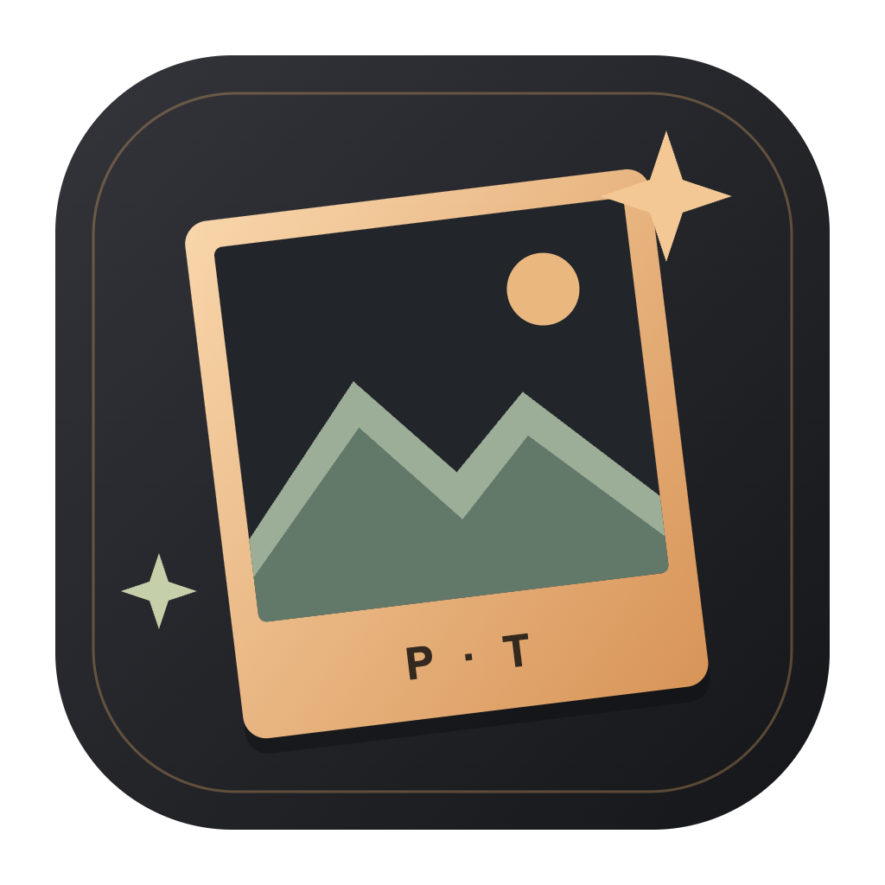
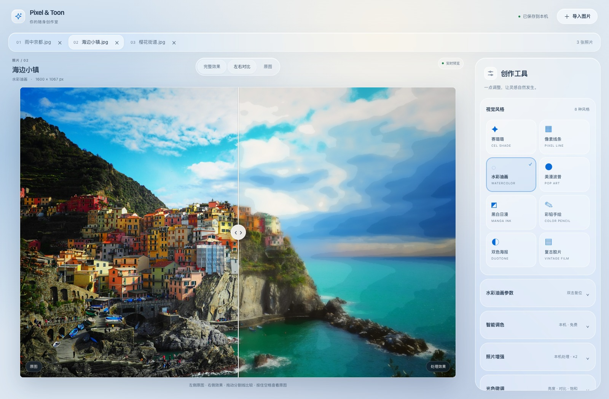
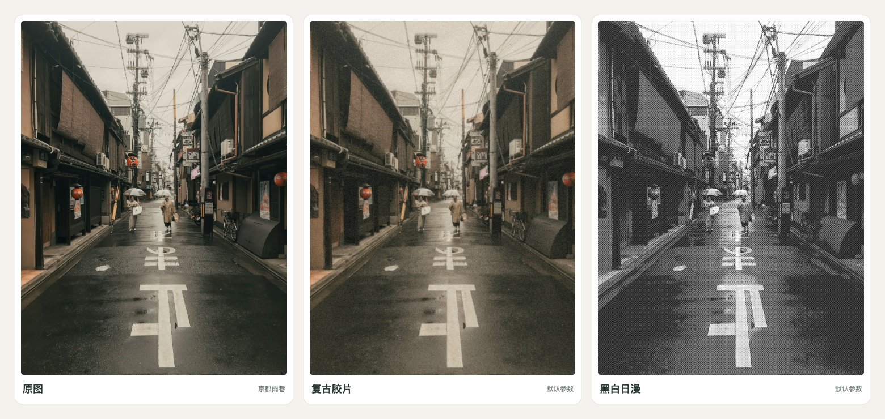
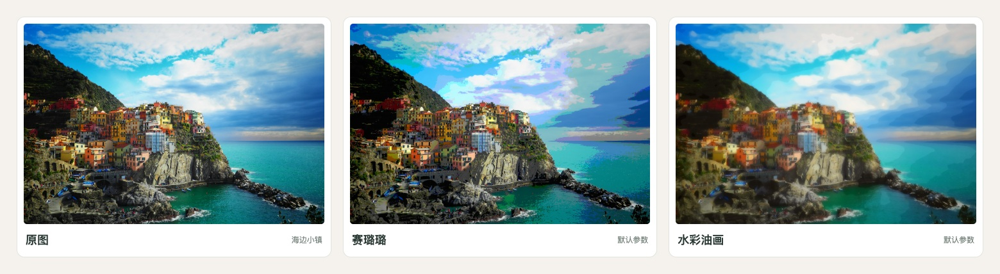
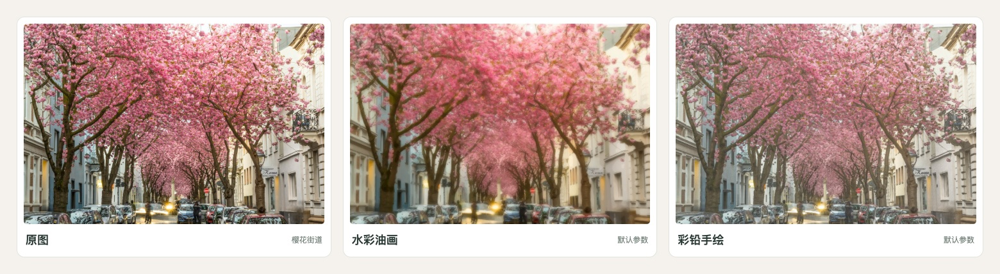
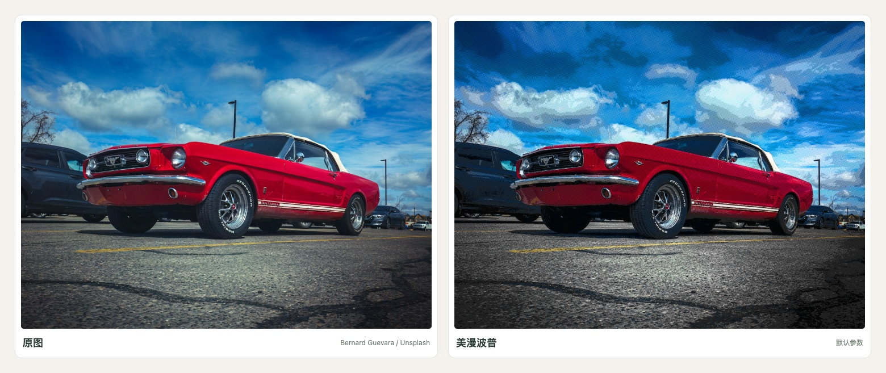
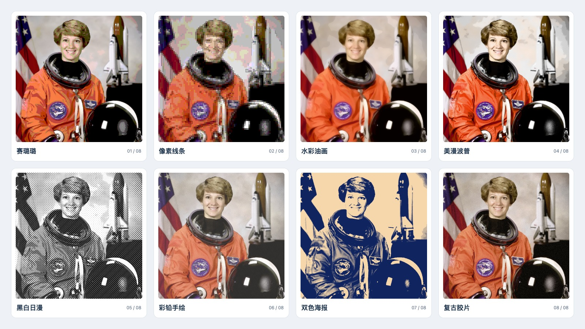
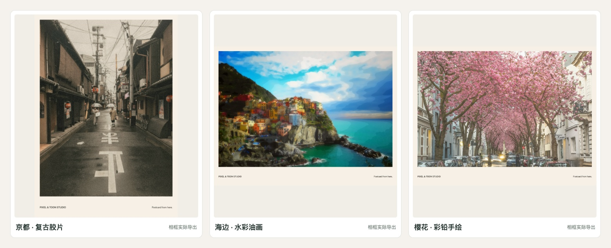

  
  <h1>Pixel & Toon Studio</h1>
  
<a href="README.md">简体中文</a> · <strong>English</strong>

  
<strong>Got the photo? Play with it a little.</strong>

  
Turn a travel snapshot into a comic panel, a watercolor, or a little postcard worth keeping.

  

    <a href="https://github.com/feihanwen0928-eng/pixel-toon-studio/releases/latest"><strong>Download for Mac ↗</strong></a>
    &nbsp; · &nbsp;
    <a href="#a-few-real-examples">See the results</a>
    &nbsp; · &nbsp;
    <a href="docs/DEVELOPMENT.md">Development guide (Chinese)</a>
  

Sometimes you like a photo just as it is, but still want to try something different. Give it the look of a comic panel, soften it into a painting, or put a paper frame around it as a small reminder of a trip.

That's what Pixel & Toon Studio is for. Drop in a photo, choose a style, make a few adjustments, and export it when you're happy. **Your photos are processed on your own device. No account, no API key.** The Mac app works offline right after installation.

## A few real examples

Four different scenes: a rainy Kyoto street, a colorful coastal town, cherry blossoms, and a red classic car. These are actual exports from the app, using default style settings with no extra retouching.

The screenshots and image labels show the app's current Chinese interface. The descriptions below are in English.

### A rainy Kyoto street, with a comic-book feel

There are plenty of wires, rooflines, and signs here to bring out the line work. Vintage Film keeps the street's brown tones with visible grain and a little softness. Manga shifts the focus toward outlines, shadows, and reflections on the wet road.

[Open the full-size Manga PNG](docs/showcase/samples/kyoto-manga.png)

### A little more color by the sea

Yellow houses, red roofs, and turquoise water make this an easy photo to experiment with. Cel Shade separates the colors into clearer blocks; Watercolor blends some of the detail into broader strokes. Two different moods from the same shot.

[Open the full-size Watercolor PNG](docs/showcase/samples/coast-watercolor.png)

### Keep the cherry blossoms soft

There's a lot of pink and a lot of detail in this one. Watercolor lets the colors blend, while Colored Pencil adds line work and paper texture. If either feels too strong, pull back the painting intensity or pencil pigment slider.

[Open the full-size Colored Pencil PNG](docs/showcase/samples/blossoms-pencil.png)

### A red Mustang in Pop Art

The red body, blue sky, and clear wheel shapes give this shot a distinct subject. With Pop Art, look at the simplified clouds, the halftone dots on the bodywork, and the outlines. This example uses default settings with Smart Color turned off.

[Open the full-size Pop Art PNG](docs/showcase/samples/mustang-pop.png)

## Eight styles to try

Choose from **Cel Shade, Pixel Line, Watercolor, Pop Art, Manga, Colored Pencil, Duotone, and Vintage Film**. Different photos suit different styles, so this gallery uses a few scenes rather than forcing one photo through all eight.

You can keep adjusting after picking a style. Make the dots finer, ease off the ink, warm up the film, or choose a different pair of colors for a duotone poster. Undo is always there, and double-clicking a slider resets it to its default.

## Make it a little postcard

Turn on the instant-photo frame, pick a caption, and export. Here, the same line — **“Postcard from here.”** — sits under three different travel photos.

There are 48 short captions in Chinese and English, browsable by theme and language. The frame and text are included in the exported PNG, so there's no need to assemble them in another app.

## Sometimes you just want a clearer photo

You can also work on the base image before adding a style:

- **Texture Clarity / LiveAction ×2** enlarges the photo and enhances texture and outlines.
- **Grain Denoise / FFDNet** reduces noise first, then enlarges the result to twice its size. It produces a softer result and is better suited to grainy photos.

For the comparison below, the coastal photo was reduced to 600 × 400, then enlarged with LiveAction and ordinary interpolation. Both crops show the same area at the same display size, with no art style applied.

These are small enhancement models. They have limits with severe defocus, motion blur, and detail that wasn't captured in the first place. You can download the enhanced base image on its own, or keep going with an art style.

For photos whose lighting or colors feel a little off, **Smart Color** can be enabled separately. Brightness, contrast, and saturation sliders are there for the finishing touches. If you already like the original colors, leave them alone.

## A few things that make editing easier

- **Phone photos are welcome.** Import HEIC / HEIF, PNG, JPEG, and WebP by choosing files, dragging them in, or pasting.
- **Keep several photos open.** Each tab has its own style and adjustments.
- **Check the original whenever you like.** Switch between the full effect and a split comparison, or hold Space to peek at the original.
- **Come back to it later.** Your workspace is saved locally and restored when you reopen the app. The Mac and browser workspaces are separate; clearing browser site data also clears the browser workspace.
- **Save the result as a PNG.** Enhancement, color adjustments, style, and frame are included. Original EXIF metadata is not copied. Export anything you want to keep long-term.
- **Open photos straight from your Mac.** Use Finder's Open With menu, or drop a photo onto the app's Dock icon.

Image decoding, filters, and model inference all run on your device. The Mac download includes the models and runtimes. The web app also works offline once the relevant resources have been cached.

## Give it a try

**[Download the latest Mac release →](https://github.com/feihanwen0928-eng/pixel-toon-studio/releases/latest)**

Currently available for **Apple Silicon · macOS 13 or later**. Open the DMG and drag the app into Applications.

The app has not yet been notarized by Apple. If macOS blocks it, you can choose Open Anyway in System Settings → Privacy & Security. The release page also includes a SHA-256 checksum file.

To run the web version, explore the code, or make changes, see the [development guide (Chinese)](docs/DEVELOPMENT.md). If something goes wrong, [open an issue](https://github.com/feihanwen0928-eng/pixel-toon-studio/issues). Steps to reproduce and a screenshot make it much easier to investigate.

---

Thanks to the photographers behind these examples: **Hamza ERBAY, Sung Jin Cho, Stephan Widua, and Bernard Guevara**. Original links are in the [image credits and production notes (Chinese)](docs/showcase/SOURCES.md). Gallery images have been resized, arranged, and compressed as JPEGs for browsing; the linked PNGs are direct app exports.

[Caption sources (Chinese)](docs/CAPTION_SOURCES.md) · [Third-party notices](desktop/THIRD_PARTY_NOTICES.md) · [MIT License](LICENSE)
