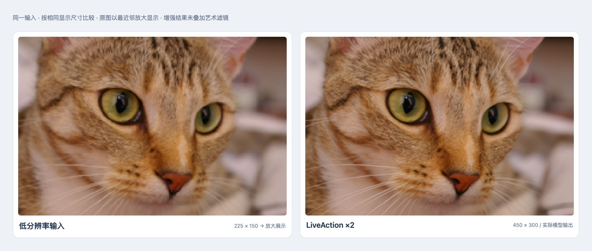

<div align="center">
  
  <h1>Pixel & Toon Studio</h1>
  <p><a href="README.md">简体中文</a> · <strong>English</strong></p>
  <p><strong>Transform everyday photos into anime stills, painted artworks, or vintage postcards.</strong></p>
  <p>100% on-device · Zero setup · Zero uploads · Privacy-first · No API keys required</p>
  <p>
    <a href="#real-world-examples">See Results</a>
    &nbsp; · &nbsp;
    <a href="#feature-overview">Feature Tour</a>
    &nbsp; · &nbsp;
    <a href="docs/DEVELOPMENT.md">Dev Guide</a>
  </p>
</div>

---


**Pixel & Toon Studio** is a private, on-device creative photo studio for your desktop and web browser. Turn your favorite snapshots into anime stills, expressive watercolors, 8-bit pixel art, vintage pop-art halftones, or nostalgic 35mm film. Complete your piece with 28 curated instant polaroid frames, 48 bilingual travel quotes, custom typography, or camera EXIF specs — ready to export as high-resolution keepsake cards in one click.

Everything happens locally on your computer: image decoding, custom canvas shaders, and neural AI models run directly on your CPU/GPU. **No accounts, no API keys, and zero photo uploads.** Your photos never leave your device.

---

## Feature Overview

- 🎨 **8 Distinct Visual Styles**: Cel Shade, 2D Pixel Line, Watercolor, Pop Art, Manga Ink, Color Pencil, Duotone, and Vintage Film. Every style includes dedicated fine-tuning sliders with double-click reset.
- 🧠 **4 On-Device AI Super-Resolution & Denoise Models**: Powered by ONNX Runtime Web with WebGPU and WASM SIMD acceleration. Includes LiveAction (texture clarity), OmniSR (all-frequency super-resolution), RealESR-Anime (clean line art), and NAFNet (natural grain denoise) with 2x upscaling, adaptive USM sharpening, and blend intensity control.
- 🖼 **28 Themed Instant Frames**: Spanning 6 curated categories (Solid Classic, Dreamy Gradient, Retro Pattern, Anime & Comic, Realistic Texture, and Handcrafted DIY), rendered dynamically to fit your photo's native aspect ratio.
- ✍️ **Curated Captions & Custom Text**: 48 bilingual travel and lifestyle quotes filterable by language and theme, plus full support for custom signatures, journal notes, or date stamps.
- 📷 **Real Camera EXIF Integration**: Automatically reads camera model, lens, shutter speed, aperture, ISO, and shooting date, elegantly framing your photo as a classic photographic data card.
- 🪄 **Smart Color & Lighting Adjustments**: Algorithmic white balance and auto-levels for one-click correction of underexposed or color-cast photos, paired with global brightness, contrast, and saturation controls.
- 📑 **Multi-Photo Tabs & One-Click Style Sync**: Open and edit multiple images in separate tabs. Seamlessly sync the active visual style, parameters, and frame settings across all open photos with a single click.
- ⚡ **Multi-Threaded Parallel Tile Export**: Web Worker tiled rendering enables fast, high-resolution PNG exports without browser freezing, automatically stripping sensitive GPS metadata for your privacy.
- 🌐 **Full Bilingual UI & 6 Theme Color Palettes**: Built-in Preferences popover and first-launch language onboarding dialog to switch live between **Chinese / English** across the entire UI (including 8 styles, all fine-tuning parameters, 28 frames, captions, and native menu bar), **System / Light / Dark** modes, and 6 glassmorphic theme color palettes (Sky Blue, Sakura Pink, Mint Forest, Sunset Amber, Lavender Aura, Midnight Indigo).
- 💻 **macOS & Windows Cross-Platform Offline Desktop App**: Native builds for both **macOS** (`.dmg`) and **Windows** (NSIS installer & standalone Portable `.exe`) featuring multi-resolution icons, OS "Open With" file associations, drag-and-drop, and platform-native shortcuts, plus offline PWA browser support.

---

## Real-World Examples

All showcase examples below are direct PNG exports from the application using default style settings, without additional post-processing or third-party retouching.

### 1. Rainy Kyoto Alley · Comic Ink & Vintage Grain

With intricate overhead wires, traditional eaves, shop signs, and wet pavement reflections, Kyoto street scenes bring out line clarity and lighting depth. **Vintage Film** preserves the warm amber tones with soft halation and realistic film grain, while **Manga Ink** strips the image down to crisp outlines, authentic screentone dots, and dramatic contrast.


> 🔗 View uncompressed full-size exports: [Kyoto · Manga Ink PNG](docs/showcase/samples/kyoto-manga.png) · [Kyoto · Vintage Film PNG](docs/showcase/samples/kyoto-film.png)

### 2. Colorful Coastal Town · Clean Shapes vs. Flowing Pigment

The vibrant cliffside houses and turquoise water of Cinque Terre make an ideal canvas for exploring color separation. **Cel Shade** quantizes tones into vivid anime-style color blocks and defined inking. **Watercolor** melts architectural details into expressive brushstrokes and wet pigment diffusion.


> 🔗 View uncompressed full-size export: [Coastal Town · Watercolor PNG](docs/showcase/samples/coast-watercolor.png)

### 3. Cherry Blossom Street · Soft Artistic Textures

Dense pink petals and street perspectives highlight painterly blending and paper textures. **Watercolor** delivers delicate color washes, while **Color Pencil** offers authentic pencil cross-hatching, pigment grain, and realistic rough sketch paper.


> 🔗 View uncompressed full-size export: [Cherry Blossoms · Color Pencil PNG](docs/showcase/samples/blossoms-pencil.png)

### 4. Red Classic Mustang · Golden-Age Pop Art Halftone

A bright red vintage car against blue skies and mechanical rims is transformed into classic 20th-century pop art. The **Pop Art** style features simulated four-color CMYK halftone dot rosettes, bold ink contours, and subtle RGB chromatic aberration.


> 🔗 View uncompressed full-size export: [Red Mustang · Pop Art PNG](docs/showcase/samples/mustang-pop.png)

---

## Style Gallery & Tuning System

Pixel & Toon Studio includes 8 visual styles fine-tuned for distinct visual expressions:


| Style Name | Artistic Character | Adjustable Parameters |
| :--- | :--- | :--- |
| **Cel Shade** | Japanese animation color flats and crisp contour inking | Quantization levels, ink strength, edge sensitivity, background protection |
| **2D Pixel Line** | Retro 8-bit / 16-bit video game illustration | Pixel size (px), line strength, detail filter, color palette count |
| **Watercolor** | Wet-on-wet paint diffusion and artistic brushwork | Brush radius, painting intensity, pigment softness, detail retention |
| **Pop Art** | Vintage comic print halftones and screenprint offset | Halftone dot size, density, ink strength, RGB shift, posterization |
| **Manga Ink** | Hand-drawn comic manga art and screentone shading | Dot size, ink strength, shadow layers, highlight protection |
| **Color Pencil** | Colored pencil sketching on textured art paper | Stroke size, line strength, pigment density, paper grain |
| **Duotone** | Modern minimalist two-tone screenprint poster art | Shadow hue, highlight hue, split threshold, detail retention (with live palette preview) |
| **Vintage Film** | Analog film simulation, warmth, silver halide grain, halation | Fade intensity, grain strength, soft diffusion, color warmth, highlight halation |

> 💡 **Tuning Tip**: Sliders update the preview in real time. Double-click any slider to quickly restore its default parameter value.

---

## On-Device AI Super-Resolution & Denoise

Alongside artistic styling, the studio provides an on-device neural enhancement engine powered by ONNX Runtime Web. Models execute locally inside dedicated Web Workers with **WebGPU hardware acceleration** and **WASM SIMD multi-threading**, utilizing intelligent tiling to handle large images smoothly.



### 4 Bundled Neural Models

1. **Texture Clarity / LiveAction (`liveaction-span-x2`)**: 2x super-resolution specialized for real-world textures, hair, fabrics, and natural landscapes.
2. **All-Frequency / OmniSR (`omnisr-x2`)**: Omni-frequency attention network balancing macro-geometric structures and micro-level surface reconstruction.
3. **Anime Lines / RealESR-Anime (`realesr-anime-x2`)**: 2x compact model optimized for anime illustrations, keeping line art clean and suppressing halftone artifacts.
4. **Natural Denoise / NAFNet (`nafnet-denoise`)**: Non-linear activation-free network tailored for eliminating low-light chroma noise and sensor grain while keeping crisp edges without plastic blur.

### Flexible Controls

- **Blend Intensity Slider (0–100%)**: Smoothly blend the enhanced AI output with the original photo to taste.
- **Adaptive Sharpening (USM)**: Apply unsharp masking after enhancement to give outlines an extra crisp pop.
- **Direct Download**: Export the enhanced 2x high-resolution base photo independently, or continue styling it with any artistic filter.

---

## Instant Polaroid Frames & Kept Cards

Turn any styled photograph into a tangible instant keepsake photo.


### 1. 28 Themed Frame Styles
Organized into 6 distinctive categories with a visual picker and quick random shuffle:
- **Solid Classic**: Classic Ivory, Darkroom Black, Sakura Pink, Mint Soda, Buttercream Yellow, Mist Blue.
- **Dreamy Gradient**: Sunset Glow, Y2K Aura, Cyber Neon, Matcha Latte.
- **Retro Pattern**: Retro Checkerboard, Pop Polka, Candy Stripes, Indigo Denim.
- **Anime & Comic**: Manga Screentone, Action Speedlines, 8-Bit Pixel RPG, Magical Starlight, Vaporwave Window.
- **Realistic Texture**: Kraft Paper, Brushed Silver, 35mm Film Strip, Crumpled Washi Paper.
- **Handcrafted DIY**: Washi Tape, Airmail Postcard, Gothic Thorn, Double Mat Border.

### 2. Captions & Custom Typography
- **48 Curated Bilingual Captions**: Spanning travel, everyday life, and reflective notes, easily browsable by language and theme.
- **Custom Note Input**: Type your own memories, location check-in, or dates directly into the dialog to render them cleanly at the base of the frame.

### 3. Native Camera EXIF Readout
- Automatically parses camera make, model, lens, shutter speed, aperture, ISO, and capture timestamp from incoming photos.
- Seamlessly toggle EXIF display to print genuine photography specs directly onto the frame.

---

## Thoughtful Workflow Features

- 🌐 **First-Launch Language Onboarding & Live Switching**: Clean bilingual onboarding modal on first run, plus an instant Settings popover in the top bar to toggle between English and Simplified Chinese at any time — dynamically updating all style parameter names, frame categories, captions, and native OS menus.
- 🎨 **Adaptive Themes & Color Palettes**: Choose between System, Light, and Dark modes, paired with 6 curated theme palettes (Sky Blue, Sakura Pink, Mint Forest, Sunset Amber, Lavender Aura, Midnight Indigo) that seamlessly tint window chrome and backdrops.
- 🖥️ **Tailored Desktop Integrations**: Drag-enabled title bar and Dock drop on macOS; native title bar controls, NSIS setup, single-file Portable `.exe`, multi-resolution `.ico` icons, Explorer file associations, and full `Ctrl` shortcut mapping on Windows.
- 📱 **Wide Format Support**: Accepts iPhone / iPad **HEIC / HEIF** formats out of the box, as well as PNG, JPEG, and WebP. Import via file picker, drag-and-drop, or clipboard paste (`Cmd/Ctrl + V`).
- 📑 **Multi-Tab Workspace**: Edit multiple photos concurrently. Each tab maintains its own independent style, adjustments, and undo/redo history.
- 🔄 **One-Click Batch Sync**: Finish dialing in the perfect look for one picture, then hit "Sync current style to all photos" to apply the same filter, parameters, and frame across all open tabs.
- 👁 **Instant Comparison**: Toggle split-screen comparison mode, or simply hold down the **Spacebar** anywhere in the app to peek at the original image instantly.
- ↶ **Full History Stack**: Robust Undo (`Cmd/Ctrl + Z`) and Redo (`Cmd/Ctrl + Shift + Z`) ensure every experiment can be undone safely.
- 💾 **Local Persistence**: State automatically saves to browser/system IndexedDB so your active workspace restores when you relaunch.
- 🛡 **Zero-Leak Privacy**: All computation happens on your CPU/GPU. Exported images automatically have sensitive GPS metadata stripped.

---

## Local Development & Building

To explore the code, customize shaders/algorithms, or build locally:

```bash
# 1. Clone repository
git clone https://github.com/feihanwen0928-eng/pixel-toon-studio.git
cd pixel-toon-studio

# 2. Install dependencies
npm install

# 3. Launch local development server
npm run dev

# 4. Run automated test suite (20 test suites, 128 unit tests)
npm test

# 5. Build production bundle
npm run build

# 6. Package Desktop App for macOS / Windows
npm run desktop:mac   # Build macOS DMG installer
npm run desktop:win   # Build Windows NSIS installer & Portable executable
```

For detailed architectural notes, worker pipelines, and packaging steps, see the [Development Guide (docs/DEVELOPMENT.md)](docs/DEVELOPMENT.md).

---

## Credits & License

- **Photography Credits**: Grateful acknowledgment to Unsplash photographers **Hamza ERBAY**, **Sung Jin Cho**, **Stephan Widua**, and **Bernard Guevara**. Detailed image sources and documentation can be found in the [Image Credits and Production Notes](docs/showcase/SOURCES.md).
- **Caption References**: [Caption Sources Documentation](docs/CAPTION_SOURCES.md).
- **Open Source License**: This project is licensed under the [MIT License](LICENSE). Third-party dependencies and model licenses are listed in [Third-Party Notices](desktop/THIRD_PARTY_NOTICES.md).
