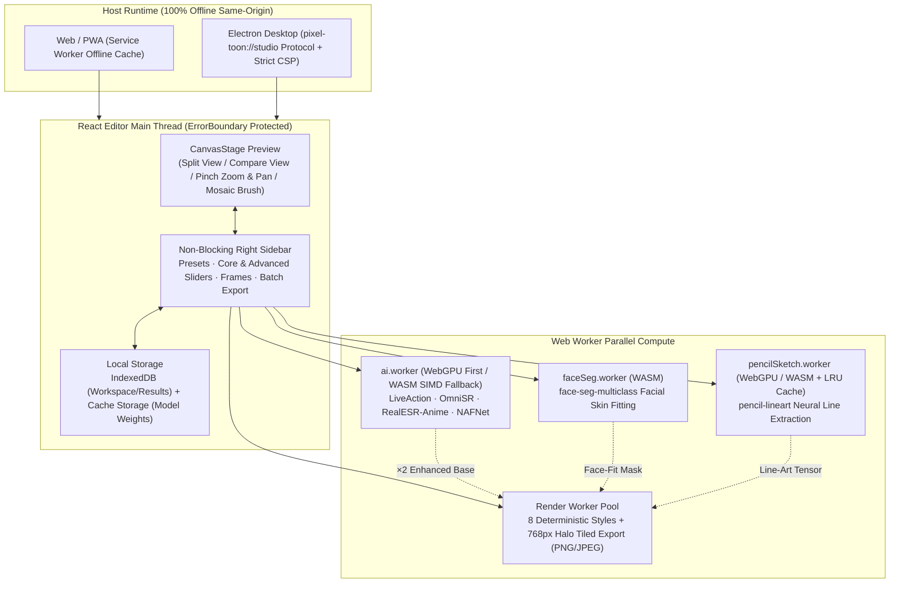
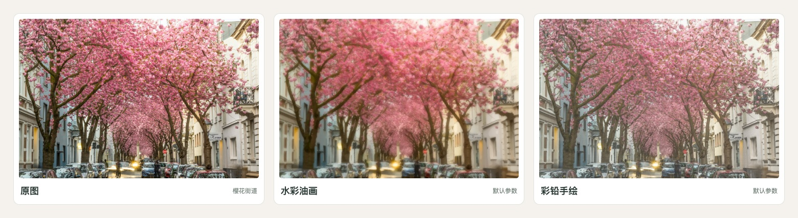

<div align="center">
  
  <h1>Pixel & Toon Studio</h1>
  <p><a href="README.zh-CN.md">简体中文</a> · <strong>English</strong></p>
  <p><strong>Transform everyday photos into anime stills, painted artworks, or vintage postcards.</strong></p>
  <p>100% on-device · Zero setup · Zero uploads · Privacy-first · No API keys required</p>
  <p>
    <a href="https://pixelstudio-g.vercel.app/"><strong>🌐 Try Live Web Demo (pixelstudio-g.vercel.app)</strong></a>
  </p>
  <p>
    <a href="#feature-overview">Features</a>
    &nbsp; · &nbsp;
    <a href="#system-architecture">Architecture</a>
    &nbsp; · &nbsp;
    <a href="#real-world-examples">See Results</a>
    &nbsp; · &nbsp;
    <a href="#style-gallery--tuning-system">Styles & Tuning</a>
    &nbsp; · &nbsp;
    <a href="#on-device-ai-engine--model-matrix">On-Device AI</a>
    &nbsp; · &nbsp;
    <a href="docs/DEVELOPMENT.md">Dev Guide</a>
  </p>
</div>

---


**Pixel & Toon Studio** is a private, on-device creative photo studio for desktop and web. Turn everyday snapshots into Cel Shaded Anime, 2D Pixel Line Art, Watercolor & Impasto, Pop Art Halftone, Manga Screentone, AI-assisted Colored Pencil Sketch, Duotone Posters, or Vintage 35mm Film. Complete your creation with **Smart Mosaic Brush (AI Face Contour Fit)**, **Smart Color v2**, **4 on-device AI super-resolution & denoise models**, **27 themed Polaroid frames**, **200 bilingual captions (100 Chinese + 100 English)**, custom text, or camera EXIF specs — ready for single or selective batch export as high-resolution **PNG / JPEG** keepsake cards.

All image decoding, canvas shader pipelines, and 6 bundled ONNX neural networks execute locally on your device. **No accounts, no API keys, and zero photo uploads.** Your photos never leave your computer.

---

## Feature Overview

- 🎨 **8 Distinct Visual Styles & Quick Presets**: Cel Shaded Anime (Oklab perceptual bilateral filtering), 2D Pixel Line Art (2×2 morphological cleanup + Sobel 4-sector NMS edges), Watercolor & Impasto, Pop Art Halftone, Manga Screentone, Colored Pencil Sketch (**with on-device neural line-art extraction + multi-angle cross-hatching**), Duotone Poster, and Vintage Film. Each style ships with **3 curated preset pills**, **3 core sliders**, and a collapsible **Advanced Tuning** drawer with double-click reset.
- 🖌 **Smart Mosaic Brush (AI Face Contour Fit)**: Paint or erase mosaic privacy masks directly on the preview canvas with adjustable Brush Size (`8–120`) and Mosaic Strength (`0–100%`). With **AI Face Contour Fit** enabled, the bundled multi-class face segmentation model snaps the mask cleanly to facial skin while keeping hair and jawlines crisp; non-face regions smoothly fall back to edge-aware diffusion. A pre-style frosted diffusion + post-style chroma guard pipeline keeps mosaic zones natural across all 8 styles and tiled HD exports.
- 🧠 **4 On-Device AI Super-Resolution & Denoise Models**: Powered by ONNX Runtime Web with **WebGPU hardware acceleration** and **CPU/WASM SIMD fallback** (switchable in More Settings). Includes LiveAction (`×2`), OmniSR (`×2`), RealESR-Anime (`×2`), and NAFNet (`1×` denoise), plus **4 Texture Presets** (Balanced, Crisp Lines, Soft Focus, Clean Denoise) and **4 post-processing sliders** (Blend Strength, Adaptive USM Sharpen, Local Clarity, Edge Denoise).
- 🪄 **Smart Color v2 & 6-Channel Light Adjustments**: Deterministic histogram & neutral-gray white balance optimizer with live diagnostic badges (*Shadows Lifted*, *Highlights Tamed*, *Contrast Boosted*, *Warmed Tone*, *Cast Corrected*), main strength slider, and 4 fine-tuning offsets (Exposure, Tone Contrast, Temperature, Vibrance) — paired with 6 global sliders (Brightness, Contrast, Saturation, Highlights, Shadows, Temperature).
- 🖼 **27 Themed Instant Polaroid Frames**: Spanning 6 curated categories (Solid Classic, Dreamy Gradient, Retro Pattern, Anime & Pop, Paper & Texture, Collage & DIY), dynamically rendered on Canvas to fit your photo's native aspect ratio with one-click shuffle.
- ✍️ **200 Bilingual Captions, Custom Text & Camera EXIF**: 100 Chinese and 100 English captions across 10 themes (including rich emotional & healing lines), filterable by language and theme (randomization uses both languages in Chinese UI mode and English-only in English UI mode unless you manually pick/filter Chinese), plus custom text notes (up to 48 characters) and privacy-consented camera EXIF readout (model, shutter speed, aperture, ISO, and capture date).
- 📑 **Multi-Tab Workspace & Selective Batch Export**: Edit multiple photos in parallel tabs with independent undo/redo history; open *Select & Export* in the sidebar to check photos (with Select All, clicking any photo switches the left canvas preview) and export as **PNG (Lossless)** or **JPEG (Compact)**.
- ⚡ **Multi-Threaded Tiled HD Export & Cross-Device Saving**: Web Worker 768 px tiled rendering with dynamic style/mosaic halo padding exports up to **24 MP / 12,000 px** seamless PNG or JPEG files while stripping sensitive GPS & EXIF metadata; supports picking save files/folders directly on Desktop and Chromium browsers, and saving straight to Phone Photos via native OS share sheet or long-press preview modal on mobile browsers.
- 🌐 **Full Bilingual UI & 6 Glassmorphic Theme Palettes**: First-launch language onboarding and Preferences popover for instant live switching between **English / 简体中文** (across all styles, sliders, frames, captions, and native desktop menus), **System / Light / Dark** appearance, and 6 theme colors (Sky Blue, Sakura Pink, Mint Forest, Sunset Amber, Lavender Aura, Midnight Indigo).
- 💻 **macOS & Windows Offline Desktop App & PWA**: Native builds for **macOS** (`.dmg`) and **Windows** (NSIS installer & standalone Portable `.exe`) with HEIC/HEIF decoding, OS file associations, drag-and-drop, Dock drop, platform shortcuts, and offline PWA support.

---

## System Architecture

All image decoding, shader pipelines, 6 ONNX neural networks, and tiled exports execute entirely on-device with zero uploads or external API requests:



---

## Real-World Examples

All showcase examples below are direct PNG exports from the application using default style settings, without additional post-processing or third-party retouching.

### 1. Rainy Kyoto Alley · Comic Ink & Vintage Grain

With intricate overhead wires, traditional eaves, shop signs, and wet pavement reflections, Kyoto street scenes bring out line clarity and lighting depth. **Vintage Film** preserves warm analog tones with soft halation, silver halide grain, and optional vignette, while **Manga Ink** strips the image down to crisp outlines, screentone dots, and cross-hatched shadows.


> 🔗 View uncompressed full-size exports: [Kyoto · Manga Ink PNG](docs/showcase/samples/kyoto-manga.png) · [Kyoto · Vintage Film PNG](docs/showcase/samples/kyoto-film.png)

### 2. Colorful Coastal Town · Clean Shapes vs. Flowing Pigment

The vibrant cliffside houses and turquoise water of Cinque Terre make an ideal canvas for color separation. **Cel Shaded Anime** leverages Oklab perceptual bilateral filtering to distill tones into vivid animation flats and crisp dark ink. **Watercolor & Impasto** melts architectural details into 16-direction flowing brushwork and wet pigment diffusion.


> 🔗 View uncompressed full-size export: [Coastal Town · Watercolor PNG](docs/showcase/samples/coast-watercolor.png)

### 3. Cherry Blossom Street · Soft Artistic Textures

Dense pink petals and street perspectives highlight painterly blending and paper textures. **Watercolor** delivers delicate wet-on-wet washes, while **Colored Pencil Sketch** pairs the on-device neural line-art model with tapered multi-angle pencil strokes and cotton paper grain.



> 🔗 View uncompressed full-size export: [Cherry Blossoms · Color Pencil PNG](docs/showcase/samples/blossoms-pencil.png)

### 4. Red Classic Mustang · Golden-Age Pop Art Halftone

A bright red vintage car against blue skies and mechanical rims is transformed into classic 20th-century pop art. **Pop Art Halftone** renders rotated Ben-Day halftone screens, multi-level posterization, bold comic ink edges, and adjustable RGB chromatic shift.


> 🔗 View uncompressed full-size export: [Red Mustang · Pop Art PNG](docs/showcase/samples/mustang-pop.png)

---

## Style Gallery & Tuning System

Pixel & Toon Studio includes 8 deeply tuned visual styles, layered with 6 global light & color sliders (Brightness, Contrast, Saturation, Highlights, Shadows, Temperature):


| Style Name | Core Pipeline & Visual Character | Adjustable Parameters |
| :--- | :--- | :--- |
| **Cel Shaded Anime** (`cel`) | Oklab perceptual bilateral flattening, cel tone steps & crisp ink | Color Levels (2–12), Ink Lines, Edge Sensitivity, BG Protection, Cel Blend, Color Pop |
| **2D Pixel Line Art** (`pixel`) | 2×2 morph open/close cleanup, Sobel + 4-sector NMS edges & dominant-color blocks | Pixel Size (2–20 px), Edge Sharpness, Morph Cleanup, Color Count (2–24), Dominant Mode, Contrast |
| **Watercolor & Impasto** (`watercolor`) | 16-direction paint flow, impasto softening & warm paper wash | Brush Size (2–18 px), Paint Flow, Pigment Blend, Detail Keep, Pigment Vivid, Paper Wash |
| **Pop Art Halftone** (`halftone`) | Rotated Ben-Day dots, posterized color planes & RGB shift | Dot Size (2–18), Dot Density, Ink Lines, RGB Shift, Posterize, Color Levels (2–10) |
| **Manga Screentone** (`manga`) | Hand-drawn ink lines, halftone screentones, highlight guard & shadow cross-hatch | Tone Size (2–16 px), Ink Lines, Shade Levels (2–10), White Guard, Ink Contrast, Cross-Hatch |
| **Colored Pencil Sketch** (`pencil`) | **AI Neural Line Art** (with XDoG/Sobel fallback), contour-following strokes & cotton paper tooth | Stroke Size (1–12 px), Sketch Line, Pigment Richness, Paper Grain, Cross-Hatch, Paper Tone |
| **Duotone Poster** (`duotone`) | Minimalist two-tone screenprint with live shadow/highlight palette swatches | Shadow Hue (0–359°), Highlight Hue (0–359°), Tone Split, Detail Keep, Color Richness, Poster Contrast |
| **Vintage Film** (`film`) | Analog fade curve, silver halide grain, soft diffusion, halation & vignette | Film Fade, Film Grain, Soft Diffusion, Warmth, Halation, Tint, Vignette |

> 💡 **Tuning Tip**: Every style includes **3 quick preset pills** and **3 core sliders**, with remaining parameters tucked into a collapsible **Advanced Tuning** drawer. All style, Smart Color, and global adjustment sliders update in real time — **double-click any slider** to restore its default value.

---

## On-Device AI Engine & Model Matrix

The application bundles **6 local ONNX neural models** (integrity-checked at build time by `scripts/verify-model.mjs` for SHA-256 hash, tensor I/O layout, and operator graph). All models run inside dedicated Web Workers via ONNX Runtime Web with **WebGPU acceleration** first and seamless **WASM SIMD CPU fallback / compatibility mode**.

| Model ID | Module | Scale / Spec | License | Purpose |
| :--- | :--- | :--- | :--- | :--- |
| `liveaction-span-x2` | Photo Enhancement · Natural Detail | ×2 Upscale (1.65 MB) | Apache-2.0 | Reconstructs hair, fabric, and natural real-world textures |
| `omnisr-x2` | Photo Enhancement · Omni-SR ×2 | ×2 Upscale (3.79 MB) | Apache-2.0 | Full-frequency attention balancing macro structure & micro detail |
| `realesr-anime-x2` | Photo Enhancement · Anime Line | ×2 Upscale (2.41 MB) | BSD-3-Clause | Compact anime/illustration upscaler with clean lines & low ringing |
| `nafnet-denoise` | Photo Enhancement · Natural Denoise | 1× Denoise (0.20 MB) | MIT | Edge-preserving denoiser removing low-light chroma noise without plastic blur |
| `face-seg-multiclass` | Smart Mosaic · AI Face Fit | 256×256 Seg (16.45 MB) | Apache-2.0 | MediaPipe multi-class segmentation snapping masks cleanly to facial skin |
| `pencil-lineart` | Colored Pencil · Neural Line Art | Dynamic ≤640 px (17.19 MB) | MIT | Informative Drawings network producing expressive pencil contour sketches |

### 1. AI Super-Resolution & Denoise


- **Smart Tiling & Caching**: Supports up to **6 MP** input (up to **24 MP / 12,000 px** max side output), caching results in IndexedDB with one-click cleanup for unused results or cached models.
- **4 Texture Presets & 4 Sliders**: Switch between *Balanced*, *Crisp Lines*, *Soft Focus*, and *Clean Denoise*, or dial in **Blend Strength (0–100%)**, **Adaptive Sharpen USM (0–100%)**, **Local Clarity (-50–100)**, and **Edge Denoise (0–100%)**.
- **Standalone Base Export**: Save the enhanced base image directly as PNG, or feed it into any artistic style filter.

### 2. Smart Mosaic Brush (AI Face Contour Fit)

- **Interactive Canvas Brushing**: Activate *Mosaic Brush* or *Eraser* to paint directly on the canvas with real-time cursor feedback, stroke undo, and clear all.
- **AI Facial Skin Snapping**: When *AI Face Contour Fit* is enabled, strokes are clustered into portrait crops and processed by `face-seg-multiclass` to lock onto facial skin while preserving hair and jawlines; non-face strokes automatically use edge-aware diffusion.
- **Cross-Style & Tile-Safe Pipeline**: Pre-style frosted mosaic + organic micro-grain (`applyPreStyleMosaic`) and post-style chroma guard (`applyPostStyleChromaGuard`) keep masked regions clean across all 8 styles and seamless across tiled exports.

### 3. Smart Color v2 (Deterministic Lighting & White Balance)

- **Automatic Diagnostics**: Analyzes full-frame luminance histograms and near-neutral highlights to balance exposure, dynamic range, and color cast, surfacing live tags (*Shadows Lifted*, *Highlights Tamed*, *Contrast Boosted*, *Warmed Tone*, *Cast Corrected*).
- **Fine-Tuning Offsets**: Adjust overall *Color Strength (0–100%)* plus *Exposure*, *Tone Contrast*, *Temperature*, and *Vibrance* (`-50` to `+50`) with one-click reset.

---

## Instant Polaroid Frames & Kept Cards

Turn any styled photograph into a tangible instant keepsake card.


### 1. 27 Themed Frame Styles

Organized into 6 categories with a visual picker, category filter, and random shuffle:
- **Solid Classic (6)**: #01 Classic Ivory, #02 Darkroom Black, #03 Sakura Blush, #04 Mint Soda, #05 Buttercream Yellow, #06 Mist Blue.
- **Dreamy Gradient (4)**: #07 Sunset Glow, #08 Y2K Aura, #09 Cyber Neon, #10 Matcha Latte.
- **Retro Pattern (4)**: #11 Retro Checkerboard, #12 Pop Polka, #13 Candy Stripes, #14 Indigo Denim.
- **Anime & Pop (5)**: #15 Manga Screentone, #16 Action Speedlines, #17 8-Bit Pixel RPG, #18 Magical Starlight, #19 Vaporwave Window.
- **Paper & Texture (4)**: #20 Kraft Paper, #21 Brushed Silver, #22 35mm Film Strip, #23 Crumpled Washi Paper.
- **Collage & DIY (4)**: #24 Washi Tape, #25 Airmail Postcard, #26 Gothic Thorn, #27 Double Mat Border.

### 2. 200 Bilingual Captions & Custom Typography

- **200 Curated Captions (100 ZH + 100 EN)**: Spanning 10 themes (*Daily Moments*, *Getaway*, *City Walk*, *Into Nature*, *With Friends*, *Sweet Time*, *Photo Dump*, *Minimal*, *Mood & Feels*, *Soft & Healing*), filterable by language and theme. Randomization picks from both Chinese and English in Chinese UI mode, and from English only in English UI mode unless you manually select or filter for Chinese captions.
- **Custom Note Input**: Type custom places, dates, or notes (up to 48 characters) directly in the picker dialog.

### 3. Native Camera EXIF Readout

- Displays a non-blocking inline privacy consent card at the top of the sidebar before parsing camera model, shutter speed, aperture, ISO, and capture date, printing genuine photography specs onto the frame border.

---

## Thoughtful Workflow Features

- 🌐 **Inline Onboarding, Bilingual UI & Localized Errors**: Non-blocking inline language selector on first launch plus a top-bar Preferences popover for instant switching between English and Simplified Chinese across all UI controls, Worker progress/error messages, and native desktop menus.
- 🎨 **Adaptive Themes & 6 Color Palettes**: System, Light, and Dark modes paired with 6 curated palettes (Sky Blue, Sakura Pink, Mint Forest, Sunset Amber, Lavender Aura, Midnight Indigo).
- 🖥️ **Desktop & Web Integrations**: macOS frosted draggable title bar, Dock drop, and `Cmd` shortcuts; Windows native title bar, NSIS installer, standalone Portable `.exe`, multi-resolution `.ico`, Explorer "Open With", and `Ctrl` shortcuts.
- 📱 **Wide Format Support**: Native **HEIC / HEIF** (iPhone/iPad), PNG, JPEG, and WebP up to 24 MP / 12,000 px via file picker, drag-and-drop, or clipboard paste (`Cmd/Ctrl + V`).
- 📑 **Multi-Tab Workspace, Dual Format & Cross-Device Batch Export**: Independent per-tab state and history; open *Select & Export* in the sidebar for Select All/Deselect All, click-to-preview, and batch export in **PNG (Lossless)** or **JPEG (Compact, 92% quality)**, with direct file/folder picking on Desktop and Chromium browsers, and native OS share-to-Photos or a long-press preview sheet with download fallback on mobile browsers (for single, batch, and enhanced base exports).
- 👁 **Dual Comparison Modes & Touch/Desktop Zoom & Pan**: Bottom-left view buttons toggle *Split View* (draggable divider) and *Compare View* (synchronized side-by-side Original vs. Styled panes), while holding **Spacebar** anywhere peeks at the original photo; zoom (`100%–500%`) via toolbar buttons (`−` / `Fit` / `+`), cursor-anchored wheel or trackpad pinch, **two-finger pinch-to-zoom with simultaneous midpoint pan**, single-finger drag pan (or `Alt`+drag / middle-click on desktop while Mosaic Brush is active), and **double-click / double-tap** to zoom or reset, with adaptive touch gesture hints.
- ↶ **Undo/Redo, Persistence & Recovery**: Full `Cmd/Ctrl + Z` / `Cmd/Ctrl + Shift + Z` history, automatic IndexedDB persistence, and a top-level React `ErrorBoundary` offering one-click recovery or reload without losing local photos.
- 🛡 **Zero-Leak Privacy**: All computation stays on your CPU/GPU; exported PNGs and JPEGs automatically strip GPS and EXIF metadata.

---

## Local Development & Building

Requires **Node.js 20+** (macOS packaging requires macOS):

```bash
# 1. Clone repository
git clone https://github.com/feihanwen/pixel-toon-studio.git
cd pixel-toon-studio

# 2. Install dependencies
npm install

# 3. Launch local development server
npm run dev

# 4. Run typecheck, model integrity verification, and full unit test suite (26 suites, 172 tests)
npm run typecheck
npm run verify:model
npm run test:run -- --maxWorkers=1

# 5. Build production bundle & preview locally
npm run build
npm start

# 6. Run or package Desktop App for macOS / Windows
npm run desktop:start # Build and launch Electron desktop app
npm run desktop:mac   # Build macOS DMG installer
npm run desktop:win   # Build Windows NSIS installer & Portable executable
```

For detailed architecture notes, worker pipelines, E2E scripts, and packaging steps, see the [Development Guide (docs/DEVELOPMENT.md)](docs/DEVELOPMENT.md).

---

## Architecture & Original Engineering

To make technical boundaries transparent for reviewers, contributors, and open-source compliance, this project separates **custom-engineered algorithms & system infrastructure** from **third-party pretrained neural models**:

### 1. Original Engineering & Custom Algorithms (Written in TypeScript)
- **Perceptual Oklab Stylization (`src/worker/shared/oklab.ts`, `src/worker/styles/cel.ts`)**: Custom separable Oklab bilateral filtering and hue-locked lightness quantization to prevent RGB channel-clipping and skin-tone hue drift in Cel Shaded Anime.
- **Structure-Tensor Painterly Rendering (`src/worker/styles/watercolor.ts`, `src/worker/styles/pencil.ts`)**: Local gradient covariance (structure tensor) orientation fields driving 16-direction anisotropic impasto brushwork, paired with multi-angle tapered colored-pencil cross-hatching.
- **Seamless Multi-Threaded Tiled Export (`src/imaging/exportHalo.ts`, `src/imaging/export.ts`, `src/enhancement/local/rgbTiles.ts`)**: Dynamic per-style `exportHalo` padding and global coordinate anchoring for artifact-free 768 px Web Worker tiled exports up to 24 MP, plus cosine-feathered Catmull-Rom tile fusion for AI super-resolution.
- **Cross-Style Privacy Mosaic Pipeline (`src/mosaic/mosaicEngine.ts`, `src/mosaic/maskMath.ts`)**: Mask-normalized pre-style frosted diffusion with sensor-matched micro-grain injection and a post-style chroma guard that keeps stylized highlights/textures intact without halo staining.
- **Deterministic Lighting & White Balance (`src/imaging/autoColor.ts`)**: Local histogram and neutral-gray highlight sampler with bidirectional gamma recovery and live diagnostic tags.
- **On-Device Security & Integrity (`scripts/verify-model.mjs`, `desktop/main.mjs`, `src/enhancement/local/ai.worker.ts`)**: Build-time Protobuf ONNX operator-graph & SHA-256 verification, runtime same-origin checksum checks, WebGPU-to-WASM SIMD automatic fallback, Electron `pixel-toon://` custom protocol with `trustedSender` IPC validation, and automatic EXIF/GPS stripping on export.

### 2. Third-Party Pretrained Models & Open-Source Attribution
All 6 bundled ONNX weights are unmodified open-source pretrained models executed locally via ONNX Runtime Web (full notices in [Third-Party Notices](desktop/THIRD_PARTY_NOTICES.md) and each model's `LICENSE` file):
- **Super-Resolution & Denoise**: `liveaction-span-x2` (Apache-2.0), `omnisr-x2` (Apache-2.0), `realesr-anime-x2` (BSD-3-Clause), `nafnet-denoise` (MIT).
- **Face Segmentation & Line Art**: `face-seg-multiclass` (MediaPipe, Apache-2.0), `pencil-lineart` (Informative Drawings, MIT).

---

## Credits & License

- **Photography Credits**: Grateful acknowledgment to Unsplash photographers **Hamza ERBAY**, **Sung Jin Cho**, **Stephan Widua**, and **Bernard Guevara**. Detailed image sources and documentation can be found in the [Image Credits and Production Notes](docs/showcase/SOURCES.md).
- **Caption References**: [Caption Sources Documentation](docs/CAPTION_SOURCES.md).
- **Open Source License**: This project is licensed under the [MIT License](LICENSE). Third-party dependencies and bundled model licenses are listed in [Third-Party Notices](desktop/THIRD_PARTY_NOTICES.md) and each model directory's `LICENSE` file.
