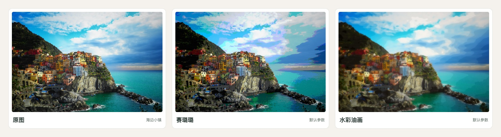

  
  <h1>Pixel & Toon Studio</h1>
  
<strong>简体中文</strong> · <a href="README.en.md">English</a>

  
<strong>照片拍好了，再玩一会儿。</strong>

  
把旅行随拍变成漫画、水彩，或者一张想留下来的小卡片。

  

    <a href="https://github.com/feihanwen0928-eng/pixel-toon-studio/releases/latest"><strong>下载 Mac 版 ↗</strong></a>
    &nbsp; · &nbsp;
    <a href="#先看几张实际效果">看看效果</a>
    &nbsp; · &nbsp;
    <a href="docs/DEVELOPMENT.md">开发说明</a>
  

拍得挺喜欢的一张照片，有时候就是想换个样子。变成一张漫画分镜，试试水彩笔触，或者加上相纸边框，存下来当作旅行的小纪念。

Pixel & Toon Studio 就是用来做这件小事的。导入照片，选个风格，调到自己喜欢，再导出。**照片在自己的设备上处理，不用注册，也不用填 API Key。** Mac 版装好后就能离线使用。

## 先看几张实际效果

这里用了四种场景：京都雨巷、彩色海滨小镇、樱花街道，还有一辆红色老车。下面都是当前版本实际导出的效果，使用默认参数，没有额外修图。

### 雨天的京都，试试漫画分镜

这张的电线、屋檐和招牌很多，适合看线条处理。复古胶片保留了街巷的棕色调，颗粒更明显，也带一点柔化；换成黑白日漫，注意力就更多落在轮廓、阴影和路面的反光上。

[打开黑白日漫 PNG 大图](docs/showcase/samples/kyoto-manga.png)

### 海边的小镇，颜色可以再放开一点

黄房子、红屋顶、蓝绿色的海，这张本来就很适合试风格。赛璐璐把色块分得更清楚，水彩油画则把细节揉进了笔触里。两种味道，留哪张看你的心情。

[打开水彩油画 PNG 大图](docs/showcase/samples/coast-watercolor.png)

### 樱花这张，想留一点软软的感觉

花很多，颜色也很满。这里放了水彩和彩铅两种处理：一个看颜料融合，一个看线稿和纸面纹理。喜欢更轻一点的效果，可以继续把画意强度或彩铅浓度往回收。

[打开彩铅手绘 PNG 大图](docs/showcase/samples/blossoms-pencil.png)

### 红色老车，试试美漫波普

红色车身、蓝天和车轮轮廓，这张的主体更清楚。换成波普后，可以看看云层的分色、车身上的网点，以及轮廓边缘的变化。下面用的是默认参数，没有再开智能调色。

[打开美漫波普 PNG 大图](docs/showcase/samples/mustang-pop.png)

## 还可以换这些风格

一共八种：**赛璐璐、像素线条、水彩油画、美漫波普、黑白日漫、彩铅手绘、双色海报、复古胶片**。不同照片适合的风格也不同，所以这里没有强行让同一张图套满八遍。

选好风格之后，还可以接着调。比如把网点收细、墨线放轻，给胶片加一点暖色，或者为双色海报重新选一组配色。参数随时能改，也能撤销；滑块双击就会回到默认值。

## 想把它做成一张小卡片

打开拍立得相框，挑一句文案，再导出就好了。这里用了同一句 **“Postcard from here.”**，放在三张不同的旅行照片上。

内置 48 条中英文短句，可以按主题和语言挑。边框和文字会一起印进导出的 PNG 里，不用再去别的软件拼一次。

## 有些照片，只想先弄清楚一点

除了换风格，也可以先处理底图：

- **纹理清晰 / LiveAction ×2**：放大照片，增强纹理和轮廓。
- **颗粒降噪 / FFDNet**：先减少噪点，再放大到两倍尺寸。细节会更柔和一些，适合有颗粒感的照片。

下面把海边照片缩小到 600 × 400，再用 LiveAction 放大，和普通插值放大放在一起看。截取的是相同位置，两边显示尺寸一致，没有叠加艺术风格。

它能做的是照片增强。严重失焦、运动模糊，或者原本就没拍到的细节，不能指望一个小模型全部补回来。增强之后可以直接下载底图，也可以继续试上面的风格。

遇到光色不太舒服的照片，还能单独打开**智能调色**，再用亮度、对比度和饱和度做一点微调。不必每张都开，原图已经喜欢的话，留着就好。

## 用起来的几个小地方

- **手机照片也能直接放进来。** 支持 HEIC / HEIF、PNG、JPEG、WebP，可以选文件、拖入或粘贴。
- **几张一起慢慢修。** 每张照片有自己的标签和设置，来回切换不会把参数串到一起。
- **随时看看原图。** 支持完整效果、左右对比；按住空格也能临时看原图，松开继续编辑。
- **关掉，下次接着来。** 工作区自动保存在本机，重新打开会恢复。网页版与 Mac 版各存各的；清理浏览器站点数据会清掉网页工作区。
- **喜欢就导出 PNG。** 风格、增强、调色和相框一起保存，不复制原始 EXIF。成品想长期留着，记得导出来。
- **Mac 上也能顺手打开照片。** 支持 Finder 的「打开方式」，或者把照片拖到 Dock 图标上。

图片解码、滤镜和模型推理都在本机完成。Mac 安装包带齐了模型和运行时；网页版在相应资源缓存后也能离线用。

## 想试试的话

**[下载最新版 Mac 安装包 →](https://github.com/feihanwen0928-eng/pixel-toon-studio/releases/latest)**

目前支持 **Apple Silicon · macOS 13 或更新版本**。打开 DMG，拖进「应用程序」就能用。

安装包暂未进行 Apple 公证。如果 macOS 阻止打开，可以在「系统设置 → 隐私与安全性」里选择「仍要打开」。下载页也放了 SHA-256 校验文件。

想跑网页版、看源码或者自己改一改，可以去看 [开发说明](docs/DEVELOPMENT.md)。遇到问题，欢迎 [开个 Issue](https://github.com/feihanwen0928-eng/pixel-toon-studio/issues)，带上操作步骤和截图会更容易排查。

---

谢谢原片的摄影师：**Hamza ERBAY、Sung Jin Cho、Stephan Widua、Bernard Guevara**。[原图与展示制作说明](docs/showcase/SOURCES.md)里保留了来源。画廊为了便于浏览做了缩放、排版和 JPEG 压缩，文中的 PNG 链接是软件直接导出的文件。

[文案来源](docs/CAPTION_SOURCES.md) · [第三方许可](desktop/THIRD_PARTY_NOTICES.md) · [MIT License](LICENSE)
