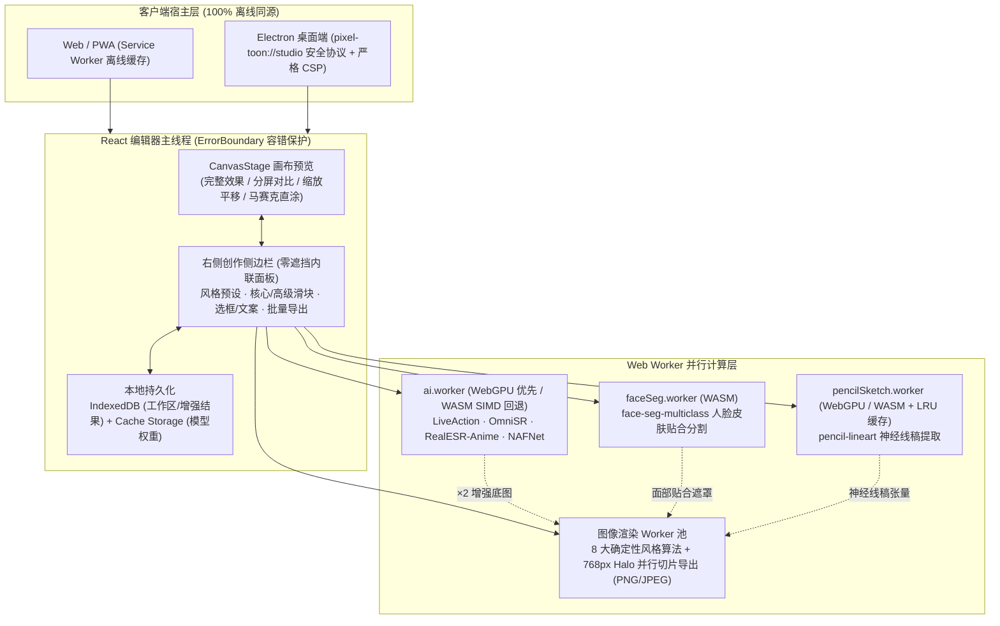

<div align="center">
  
  <h1>Pixel & Toon Studio</h1>
  <p><strong>简体中文</strong> · <a href="README.en.md">English</a></p>
  <p><strong>让每一张日常照片，都变成动漫分镜、手绘艺术或怀旧明信片。</strong></p>
  <p>纯本地端离线运行 · 零配置 · 零上传 · 保护隐私 · 无需 API Key</p>
  <p>
    <a href="https://pixelstudio-y.vercel.app/"><strong>🌐 在线体验 Web Demo (pixelstudio-y.vercel.app)</strong></a>
  </p>
  <p>
    <a href="#核心功能一览">核心功能</a>
    &nbsp; · &nbsp;
    <a href="#系统架构设计">系统架构</a>
    &nbsp; · &nbsp;
    <a href="#实际效果案例">效果样例</a>
    &nbsp; · &nbsp;
    <a href="#风格画廊与参数系统">风格与参数</a>
    &nbsp; · &nbsp;
    <a href="#本机端-ai-引擎与模型矩阵">本机 AI 引擎</a>
    &nbsp; · &nbsp;
    <a href="docs/DEVELOPMENT.md">开发说明</a>
  </p>
</div>

---


**Pixel & Toon Studio** 是一款专注让静态照片焕发艺术质感的本地图像创作工具。只需导入一张随拍，就能将其转换为赛璐璐二次元动漫、2D 线条像素、水彩油画、美漫波普、黑白日漫、AI 线稿彩铅手绘、双色海报或复古胶片风格；同时内置 **AI 面部贴合马赛克**、**智能调色 v2**、**4 款本机 AI 超分降噪模型**、**27 款拍立得相框**、**48 条中英文双语文案**、自定义文字以及相机 EXIF 摄影参数，支持单张或勾选批量导出高清 **PNG / JPEG** 艺术卡片。

所有图像解码、滤镜着色器渲染与 6 个内置 ONNX 神经网络模型推理都在你的本地设备上独立完成，**无需联网、不用注册账号、无需配置任何 API Key**，你的照片隐私 100% 留在自己手中。

---

## 核心功能一览

- 🎨 **8 大视觉艺术风格与一键预设**：涵盖赛璐璐动漫（Oklab 感知双边滤波）、2D 线条像素（形态学清理 + 4 方向 NMS 边缘）、水彩油画、美漫波普、黑白日漫、彩铅手绘（**内置 AI 神经网络线稿提取 + 轮廓排线**）、双色海报与复古胶片。每款风格提供 **3 组风格预设胶囊**、**3 项核心主滑块**与可折叠的**高级微调**参数，双击滑块即可复位。
- 🖌 **智能马赛克涂抹（AI 自动贴合面部）**：直接在画布上涂抹或擦除遮挡区域，支持画笔大小（8–120）与强度（0–100%）实时调节。开启「AI 自动贴合面部」后，内置人脸多类别分割模型会自动抠出面部皮肤并避开发丝与下颌轮廓；非人脸区域自动启用边缘感知柔和扩散，并通过「风格前磨砂 + 风格后色度保护」管线无缝兼容全部 8 种滤镜与切片高清导出。
- 🧠 **4 种本机端 AI 超分与降噪模型**：内置 LiveAction（纹理清晰 ×2）、OmniSR（全频超分 ×2）、RealESR-Anime（动漫线条 ×2）以及 NAFNet（保边自然降噪），支持 WebGPU 硬件加速与 CPU/WASM 兼容模式切换，提供 **4 组质感预设**（自然均衡 / 锐利线条 / 柔和柔焦 / 洁净去噪）与 **4 项后处理微调**（增强混合强度、自适应 USM 锐化、局部质感 Clarity、保边降噪）。
- 🪄 **智能调色 v2 与 6 维全局光色微调**：本地确定性直方图与中性灰白平衡校正算法，实时输出光色诊断标签（暗部提亮 / 高光收敛 / 动态反差 / 去青暖调 / 去黄校正），支持调色强度及曝光补偿、通透对比、色温冷暖、自然饱和 4 项精调；配合全局亮度、对比度、饱和度、高光、阴影、色温 6 项滑块，自由掌控画面光影。
- 🖼 **27 款主题拍立得相框**：涵盖纯色经典、梦幻渐变、几何复古、动漫二次元、材质肌理与手账做旧 6 大主题分类，自动匹配照片原生比例并支持 Canvas 高精度渲染与一键随机切换。
- ✍️ **相框文案、自定义文字与相机 EXIF**：内置 48 条中英文双语精选文案（8 大主题、按语言与主题筛选），支持输入自定义文字（最长 48 字符）；亦可在授权后自动读取相机型号、快门、光圈、ISO 与拍摄日期，优雅印入相纸底部。
- 📑 **多图标签页与勾选批量导出**：支持同时打开与独立编辑多张照片；通过「选择照片并导出」在侧边栏勾选导出目标（支持全选，点击任一照片即自动切换左侧预览），并支持导出为 **PNG（无损）** 或 **JPEG（高画质轻量）**。
- ⚡ **多线程切片并行导出与自定义保存位置**：基于 Web Worker 的 768 px 动态 Halo 切片并行渲染技术，最高支持 24 MP / 单边 12,000 px 高清导出，确保超大尺寸与跨切片风格无缝衔接，并在导出时自动抹除 GPS 与 EXIF 敏感元数据；桌面端与支持的浏览器（Chrome/Edge）可直接选择本地保存文件或文件夹位置。
- 🌐 **全功能中英双语与 6 款毛玻璃主题色**：内置首次启动语言引导与偏好设置面板，支持实时切换 **简体中文 / English**（覆盖全部风格、参数、相框、文案与桌面原生菜单栏）、**跟随系统 / 浅色 / 深色**外观模式，以及 6 款主题色（天空蓝、樱花粉、薄荷森、落日珀、极光紫、深空靛）。
- 💻 **macOS & Windows 跨平台全离线运行**：提供 macOS（`.dmg`）与 Windows（NSIS 安装包 / Portable 便携版）双平台桌面端，支持系统级「打开方式」关联、原生拖拽、Dock 拖入、HEIC/HEIF 解码与完整平台快捷键，同时支持 Web 端离线 PWA 运行。

---

## 系统架构设计

所有图像解码、滤镜着色器渲染、6 个 ONNX 神经网络推理与高清切片导出均在本地设备完成，无任何云端上传或外部 API 请求：



---

## 实际效果案例

以下样例均使用默认风格参数直接导出，未经过任何第三方软件二次调色或修图。

### 1. 雨天的京都 · 漫画分镜与胶片质感

京都街巷错落的电线、屋檐招牌与石板路反光，非常适合展现线条轮廓与光影细节。**复古胶片**保留街巷温润色调，并赋予细腻的卤化银颗粒、高光晕染与胶片暗角；切换至**黑白日漫**，画面则转为利落的墨线、网点与阴影排线，宛如漫画单行本分镜。


> 🔗 查看原尺寸无损导出大图：[京都 · 黑白日漫 PNG](docs/showcase/samples/kyoto-manga.png) · [京都 · 复古胶片 PNG](docs/showcase/samples/kyoto-film.png)

### 2. 彩色海滨小镇 · 色彩与笔触的碰撞

五渔村色彩斑斓的悬崖房屋与蓝绿色海水，是测试色彩分割的理想素材。**赛璐璐动漫风**基于 Oklab 感知双边滤波将色彩提炼为分明的高彩动漫色阶与清晰勾线；而**水彩油画风**通过方向流动笔触与颜料融合，将细节渲染为梦幻的艺术油画感。


> 🔗 查看原尺寸无损导出大图：[海滨小镇 · 水彩油画 PNG](docs/showcase/samples/coast-watercolor.png)

### 3. 樱花街道 · 柔和治愈的手绘质感

大面积的粉色花瓣与街景，适合体验手绘笔触与纸张质感。**水彩油画**带来颜料湿画法的晕染与渐变；**彩铅手绘**通过本机 AI 线稿模型提取干净素描轮廓，结合多方向渐细彩铅排线与棉质画纸肌理，还原细腻温柔的手绘质感。


> 🔗 查看原尺寸无损导出大图：[樱花街道 · 彩铅手绘 PNG](docs/showcase/samples/blossoms-pencil.png)

### 4. 红色老车 · 美漫波普复古网点

鲜艳的红色车身、轮胎钢圈与蔚蓝天空，在**美漫波普**风格下展现出经典的黄金年代印刷美感：色块分离、Ben-Day 印刷网点、加粗边缘线条与可调的 RGB 错位质感。


> 🔗 查看原尺寸无损导出大图：[红色老车 · 美漫波普 PNG](docs/showcase/samples/mustang-pop.png)

---

## 风格画廊与参数系统

Pixel & Toon Studio 内置 8 种经过深度算法调校的视觉风格，并在各风格之上叠加 6 项全局光色微调（亮度、对比度、饱和度、高光、阴影、色温）：


| 风格名称 | 核心算法与视觉特征 | 可调参数 |
| :--- | :--- | :--- |
| **赛璐璐动漫风** (`cel`) | Oklab 感知双边滤波平滑、动画色阶与利落勾线 | 色阶 (2–12 级)、墨线强度、边缘灵敏度、背景保护、色阶融合、色彩鲜明 |
| **2D 线条像素** (`pixel`) | 2×2 形态学开闭清理、Sobel + 4 方向 NMS 边缘、主色块降采样 | 像素尺寸 (2–20 px)、边缘锐度、噪点清理、色块数量 (2–24 色)、主色锁定、色彩对比 |
| **水彩油画风** (`watercolor`) | 16 方向颜料流动与笔触融合、厚涂柔化与纸面暖调 | 笔触尺寸 (2–18 px)、画意强度、颜料融合、细节保留、颜料浓艳、纸面暖调 |
| **美漫波普网点** (`halftone`) | Ben-Day 旋转网点、多级色块分离与 RGB 分色错版 | 网点大小 (2–18)、网点强度、墨线强度、RGB 错位、色块强度、色阶数 (2–10 级) |
| **黑白日漫** (`manga`) | 传统漫画手绘稿、网点阴影、留白保护与暗部排线 | 网点尺寸 (2–16 px)、墨线强度、阴影层次 (2–10 级)、留白保护、黑白反差、阴影排线 |
| **彩铅手绘** (`pencil`) | **AI 线稿提取**（含 XDoG/Sobel 回退）、多角度彩铅排线与棉纸肌理 | 笔触尺寸 (1–12 px)、线稿强度、彩铅浓度、纸张质感、交叉排线、纸色冷暖 |
| **双色海报** (`duotone`) | 现代极简双色丝网印刷，内置暗部/亮部实时配色预览 | 暗部色相 (0–359°)、亮部色相 (0–359°)、分色位置、层次保留、色彩浓烈、明暗反差 |
| **复古胶片** (`film`) | 胶片褪色曲线、银盐颗粒、柔化涂抹、高光光晕与暗角 | 褪色强度、颗粒强度、柔化涂抹、色温、高光晕染、绿品偏色、胶片暗角 |

> 💡 **参数调节小贴士**：每款风格均提供 **3 组一键预设胶囊**与 **3 项核心主滑块**，其余参数收起在可折叠的「高级微调」抽屉中；所有风格滑块、智能调色滑块与全局光色滑块均支持实时响应，**双击任意滑块**即可快速恢复为默认数值。

---

## 本机端 AI 引擎与模型矩阵

软件内置 **6 个本地 ONNX 神经网络模型**（由 `scripts/verify-model.mjs` 在构建时强制校验 SHA-256 哈希、张量 I/O 与算子图），全部通过 ONNX Runtime Web 在独立 Web Worker 中离线执行，优先使用 **WebGPU 硬件加速**，并支持无缝回退或手动切换至 **WASM SIMD 多线程（CPU 兼容模式）**。

| 模型 ID | 用途模块 | 倍率 / 规格 | 开源协议 | 核心作用 |
| :--- | :--- | :--- | :--- | :--- |
| `liveaction-span-x2` | 照片增强 · 纹理清晰 | ×2 超分 (1.65 MB) | Apache-2.0 | 重建真实照片的头发、织物与自然纹理细节 |
| `omnisr-x2` | 照片增强 · 全频超分 | ×2 超分 (3.79 MB) | Apache-2.0 | Omni-SR 全频域注意力，兼顾宏观轮廓与微纹理 |
| `realesr-anime-x2` | 照片增强 · 动漫线条 | ×2 超分 (2.41 MB) | BSD-3-Clause | 专为插画与二次元打造，线条锐利并抑制网点瑕疵 |
| `nafnet-denoise` | 照片增强 · 颗粒降噪 | 1× 降噪 (0.20 MB) | MIT | 非线性保边降噪，抑制暗部颗粒与彩噪，拒绝涂抹感 |
| `face-seg-multiclass` | 智能马赛克 · 面部贴合 | 256×256 分割 (16.45 MB) | Apache-2.0 | MediaPipe 多类别分割，自动抠出面部皮肤并避开发丝轮廓 |
| `pencil-lineart` | 彩铅手绘 · 神经线稿 | ≤640 px 动态尺寸 (17.19 MB) | MIT | Informative Drawings 线稿网络，生成自然流畅的铅笔素描线稿 |

### 1. AI 照片超分与质感增强


- **智能切片与缓存**：支持最高 **6 MP** 输入（输出最高 **24 MP / 单边 12,000 px**），自动切片并缓存在本地 IndexedDB 中，支持一键清理闲置结果或清除模型缓存。
- **4 组质感预设与 4 项精调**：一键切换「自然均衡 / 锐利线条 / 柔和柔焦 / 洁净去噪」，自由调节**增强混合强度 (0–100%)**、**自适应 USM 锐化 (0–100%)**、**局部质感 Clarity (-50–100)** 与**保边降噪 (0–100%)**。
- **独立底图导出**：支持单独保存增强后的无损高清底图 PNG，也可直接作为后续全部艺术风格滤镜的底图输入。

### 2. 智能马赛克涂抹（AI 自动贴合面部）

- **画布直涂交互**：在创作面板开启「涂抹画笔」或「橡皮擦」后，直接在右侧预览画布拖动即可绘制或擦除遮挡区域，支持实时光标预览、撤销一笔与一键清空。
- **AI 面部轮廓吸附**：当「AI 自动贴合面部」开启时，Worker 会自动聚类笔刷覆盖区域并调用 `face-seg-multiclass` 模型分离面部皮肤与头发、衣物及背景，精准贴合脸部轮廓；非人脸区域自动退化为边缘感知柔和扩散。
- **全风格跨切片兼容**：通过前置低感磨砂扩散 + 有机微颗粒注入（`applyPreStyleMosaic`）以及滤镜后色度保护（`applyPostStyleChromaGuard`），确保马赛克区域在赛璐璐、美漫波普、水彩、彩铅等全部 8 种风格与大图切片导出中自然融合、无接缝。

### 3. 智能调色 v2（本地确定性光色优化）

- **自动光色分析**：开启「优化底图光色」后，算法会基于全图直方图与中性灰高光采样自动计算曝光、对比度与白平衡增益，并展示实时诊断标签（如「暗部提亮 · 动态反差 · 去青暖调」）。
- **5 项可控滑块**：提供整体「调色强度 (0–100%)」及「曝光补偿」「通透对比」「色温冷暖」「自然饱和」（均支持 -50 至 +50 微调与一键重置）。

---

## 拍立得相框与定制卡片

你可以为照片开启拍立得相纸边框，将其打造成一张张精致的实体感艺术卡片。


### 1. 27 款主题相框外观

涵盖 6 大类别，内置直观的可视化选择器、分类筛选与一键随机切换：

- **纯色经典 (6 款)**：#01 经典象牙白、#02 暗房纯黑、#03 樱花奶粉、#04 薄荷苏打、#05 奶油鹅黄、#06 雾霾灰蓝。
- **梦幻渐变 (4 款)**：#07 日落晚霞、#08 Y2K 千禧光晕、#09 赛博霓虹、#10 抹茶拿铁。
- **几何复古 (4 款)**：#11 复古棋盘格、#12 波普圆点、#13 糖果条纹、#14 水洗牛仔。
- **动漫二次元 (5 款)**：#15 日漫网点、#16 热血速度线、#17 8-bit 像素 RPG、#18 魔法星芒、#19 蒸汽波视窗。
- **材质肌理 (4 款)**：#20 牛皮纸复古、#21 金属银拉丝、#22 胶片盘齿孔、#23 揉皱和纸。
- **手账与做旧 (4 款)**：#24 彩色和纸胶带、#25 航空明信片、#26 哥特荆棘、#27 双重画框。

### 2. 48 条双语文案与自定义文字

- **48 条中英文随行文案**：覆盖日常碎片、出逃计划、城市漫游、山野来信、见面快乐、恋爱日常、随便发发、极简短句 8 大主题，支持按语言与主题快速筛选。
- **自定义文字输入**：在弹窗中直接输入地点打卡、心情随笔或日期备忘（最多 48 字符），自动居中排版于相纸底部。

### 3. 相机 EXIF 拍摄参数读取

- 导入带有 EXIF 元数据的照片时，会在右侧栏顶部以零遮挡内联卡片提示隐私授权；同意后仅读取**相机型号、快门速度、光圈值、ISO 与拍摄日期**，自动替代文案印入相纸底部，呈现专业摄影数据卡片质感。

---

## 舒适好用的操作细节

- 🌐 **双语支持、内联引导与错误本地化**：首次启动在右侧栏顶部提供零遮挡内联双语引导；右上角「设置」面板支持随时切换 **简体中文 / English**，风格参数、相框类别、文案主题、Worker 推理进度、错误提示与桌面端原生菜单栏实时联动。
- 🎨 **主题色与个性化外观**：支持**跟随系统 / 浅色 / 深色**外观模式，搭配 6 款精选主题色（天空蓝、樱花粉、薄荷森、落日珀、极光紫、深空靛）。
- 🖥️ **跨平台桌面端专属优化**：macOS 支持磨砂可拖拽顶栏、Dock 拖入打开与 `Cmd` 快捷键；Windows 支持深浅色无缝标题栏、NSIS 安装向导、绿色便携版（Portable）、多分辨率 `.ico` 图标、资源管理器文件关联与 `Ctrl` 快捷键。
- 📱 **多格式与多入口导入**：支持 iPhone / iPad 原生 **HEIC / HEIF**、PNG、JPEG 与 WebP（最大导入 24 MP / 单边 12,000 px）；支持点击选择、系统拖拽与剪贴板粘贴（`Cmd/Ctrl + V`）。
- 📑 **多标签工作区、双格式与批量导出**：每张照片独立保存编辑状态与历史栈；在侧边栏打开「选择照片并导出」支持全选/取消、点击切换左侧预览，并可选择 **PNG 无损** 或 **JPEG 轻量（92% 质量）** 导出；桌面端与支持的浏览器（Chrome/Edge）可直接指定保存文件或批量导出文件夹。
- 👁 **多种实时对比与高精度缩放平移**：支持「完整效果」「左右对比（可拖拽分割线）」「原图」三种视图模式，支持工具栏按钮（`−` / `适应` / `+`）、以鼠标为锚点的滚轮缩放、触控板与双指捏合缩放（100%–500%）、放大拖拽平移（涂抹马赛克时可按住 `Alt` 或中键平移）及双击画布复位；编辑任意参数时长按 **空格键 (Space)** 即可瞬时偷窥原图，松开恢复。
- ↶ **完整撤销/重做、本地持久化与容错恢复**：支持 `Cmd/Ctrl + Z` 撤销与 `Cmd/Ctrl + Shift + Z` 重做；工作区状态与增强结果自动持久化至本机 IndexedDB，重启或刷新后无缝恢复，并内置全局 `ErrorBoundary` 异常恢复保护。
- 🛡 **零上传隐私设计**：所有计算 100% 在本机完成，导出高清 PNG / JPEG 时自动剥离 GPS 定位及原始 EXIF 元数据。

---

## 本地开发与构建

需要 **Node.js 20+**（macOS 桌面端打包需在 macOS 环境执行）：

```bash
# 1. 克隆代码仓库
git clone https://github.com/feihanwen0928-eng/pixel-toon-studio.git
cd pixel-toon-studio

# 2. 安装依赖
npm install

# 3. 启动本地开发服务器
npm run dev

# 4. 运行类型检查、模型完整性校验与全套单元测试 (25 个测试文件，166 个测试用例)
npm run typecheck
npm run verify:model
npm run test:run -- --maxWorkers=1

# 5. 构建 Web 生产包并本地预览
npm run build
npm start

# 6. 启动或打包 macOS / Windows 桌面端应用
npm run desktop:start # 构建并启动 Electron 桌面端
npm run desktop:mac   # 构建 macOS DMG 安装包
npm run desktop:win   # 构建 Windows NSIS 安装包与 Portable 便携版
```

更多目录结构、测试命令（含浏览器 E2E 与桌面端回归脚本）及限制说明请参阅 [开发说明文档 (docs/DEVELOPMENT.md)](docs/DEVELOPMENT.md)。

---

## 鸣谢与许可

- **摄影作品**：感谢 Unsplash 摄影师 **Hamza ERBAY**、**Sung Jin Cho**、**Stephan Widua**、**Bernard Guevara** 提供的优质原图素材。详细原片信息与拍摄说明见 [原图来源说明文档](docs/showcase/SOURCES.md)。
- **文案引用**：[文案来源说明文档](docs/CAPTION_SOURCES.md)。
- **开源协议**：本项目基于 [MIT License](LICENSE) 协议开源。第三方开源依赖与内置模型许可证声明见 [第三方许可声明](desktop/THIRD_PARTY_NOTICES.md) 及各模型目录下的 `LICENSE` 文件。
