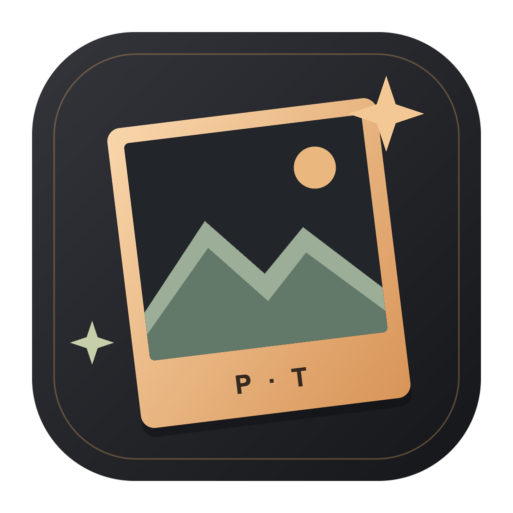
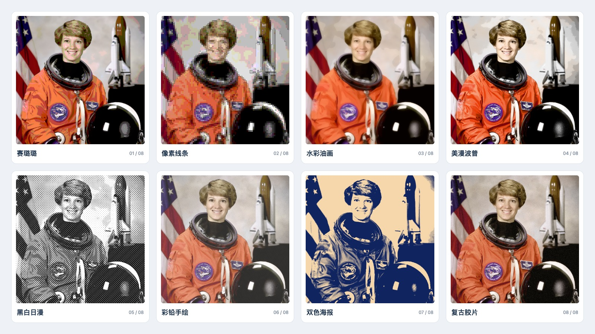
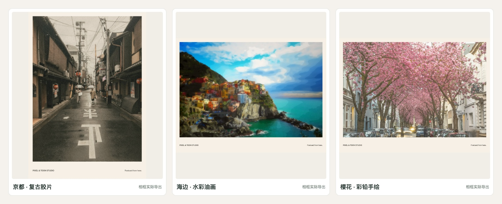

<div align="center">
  
  <h1>Pixel & Toon Studio</h1>
  <p><strong>简体中文</strong> · <a href="README.en.md">English</a></p>
  <p><strong>让每一张日常照片，都变成动漫分镜、手绘艺术或怀旧明信片。</strong></p>
  <p>纯本地端离线运行 · 零配置 · 零上传 · 保护隐私 · 无需 API Key</p>
  <p>
    <a href="#实际效果案例">效果样例</a>
    &nbsp; · &nbsp;
    <a href="#核心功能一览">功能详解</a>
    &nbsp; · &nbsp;
    <a href="docs/DEVELOPMENT.md">开发说明</a>
  </p>
</div>

---


**Pixel & Toon Studio** 是一款专注让静态照片焕发艺术质感的本地图像创作工具。只需导入一张随拍，就能将其转换为赛璐璐二次元动漫、水彩手绘、像素复古、美漫波普或经典胶片风格。搭配内置的 28 款拍立得相框、48 条中英文双语文案、自定义文字以及相机 EXIF 摄影参数，一键就能导出极具质感的艺术小卡片。

无论是风景、街道、建筑还是车辆，所有图像解码、滤镜渲染与 AI 模型推理都在你的本地设备上独立完成，**无需联网、不用注册账号、无需配置任何 API Key**，你的照片隐私 100% 留在自己手中。

---

## 核心功能一览

- 🎨 **8 大视觉艺术风格**：涵盖赛璐璐动漫、2D 线条像素、水彩油画、美漫波普、黑白日漫、彩铅手绘、双色海报与复古胶片。每个风格均支持多维度的参数细调，双击滑块即可复位。
- 🧠 **4 种本机端 AI 超分与降噪模型**：内置 LiveAction（纹理清晰）、OmniSR（全频超分）、RealESR-Anime（动漫线条）以及 NAFNet（颗粒降噪），支持 2 倍无损超分辨率、自适应锐化（USM）与自由强度混合。
- 🖼 **28 款主题拍立得相框**：涵盖纯色经典、梦幻渐变、几何复古、动漫二次元、材质肌理与手账做旧 6 大主题分类，自动匹配照片比例并采用 Canvas 高精度自适应渲染。
- ✍️ **相框文案与自定义文字**：内置 48 条精选旅行与生活文案（支持按中英文及主题快速筛选），并支持随心输入自定义文字与便签。
- 📷 **相机真实 EXIF 信息展示**：自动读取照片拍摄设备、光圈、快门、ISO 与拍摄日期，以摄影参数卡片的形式优雅印入相纸底部。
- 🪄 **智能调色与光色微调**：内置智能白平衡与色彩平衡校正算法，一键还原暗光与偏色；提供全局亮度、对比度与饱和度微调工具。
- 📑 **多图标签页与一键批量同步**：支持多张照片同时打开与独立编辑，并支持一键将当前视觉风格与参数同步至全部打开的照片，批量处理得心应手。
- ⚡ **多线程切片并行导出**：基于 Web Worker 切片并行渲染技术，超大尺寸照片也能快速无损导出高清 PNG，且自动抹除 GPS 等敏感隐私元数据。
- 💻 **跨平台与全离线运行**：提供 macOS 专属桌面端（支持 Apple Silicon、原生文件关联与拖入 Dock 打开），并支持 Web 端离线 PWA 运行。

---

## 实际效果案例

以下样例均使用当前版本的默认参数直接导出，未经过任何第三方软件二次调色或修图。

### 1. 雨天的京都 · 试一试漫画分镜与胶片质感

京都街巷错落的电线、屋檐招牌与石板路反光，非常适合展现线条轮廓与光影细节。**复古胶片**能够保留街巷温润的棕褐色调，并赋予细腻的胶片颗粒与高光晕染；而切换至**黑白日漫**，画面则转为利落的墨线、网点与阴影块面，宛如漫画单行本分镜。


> 🔗 查看原尺寸无损导出大图：[京都 · 黑白日漫 PNG](docs/showcase/samples/kyoto-manga.png) · [京都 · 复古胶片 PNG](docs/showcase/samples/kyoto-film.png)

### 2. 彩色海滨小镇 · 色彩与笔触的碰撞

五渔村色彩斑斓的悬崖房屋与蓝绿色海水，是测试色彩分割的理想素材。**赛璐璐动漫风**将色彩提炼为分明的高彩动漫阶梯与清晰勾线；而**水彩油画风**则通过流动的笔触与颜料融合，将细节渲染为梦幻的艺术油画感。


> 🔗 查看原尺寸无损导出大图：[海滨小镇 · 水彩油画 PNG](docs/showcase/samples/coast-watercolor.png)

### 3. 樱花街道 · 柔和治愈的手绘质感

大面积的粉色花瓣与街景，适合体验手绘笔触与纸张质感。**水彩油画**带来颜料湿画法的晕染与渐变；**彩铅手绘**则带来细腻的铅笔线条、颗粒感浓度与真实的糙面纸张肌理。


> 🔗 查看原尺寸无损导出大图：[樱花街道 · 彩铅手绘 PNG](docs/showcase/samples/blossoms-pencil.png)

### 4. 红色老车 · 美漫波普复古网点

鲜艳的红色车身、轮胎钢圈与蔚蓝天空，在**美漫波普**风格下展现出经典的黄金年代印刷美感：色块分离、四色印刷网点、加粗边缘线条与可调的 RGB 错位质感。


> 🔗 查看原尺寸无损导出大图：[红色老车 · 美漫波普 PNG](docs/showcase/samples/mustang-pop.png)

---

## 风格画廊与参数系统

Pixel & Toon Studio 内置 8 种经过反复调校的视觉风格，满足不同照片场景的表达需求：



| 风格名称 | 核心特征 | 可调参数 |
| :--- | :--- | :--- |
| **赛璐璐动漫风** (Cel Shade) | 经典日系动画上色、层次分明、勾线利落 | 色阶级数、墨线强度、边缘灵敏度、背景保护 |
| **2D 线条像素** (Pixel Line) | 复古 8-bit / 16-bit 像素插画、轮廓与色块提炼 | 像素尺寸 (px)、线条强度、细节过滤、色块数量 |
| **水彩油画风** (Watercolor) | 颜料流动与笔触融合、柔美绘画质感 | 笔触尺寸、画意强度、颜料融合、细节保留 |
| **美漫波普网点** (Pop Art) | 20 世纪复古美漫印刷网点、分色与错版质感 | 网点大小、网点强度、墨线强度、RGB 错位、色块强度 |
| **黑白日漫** (Manga Ink) | 传统漫画手绘稿、网点阴影、黑白留白 | 网点尺寸、墨线强度、阴影层次、留白保护 |
| **彩铅手绘** (Color Pencil) | 彩色铅笔排线与素描感、仿真纸面纹理 | 笔触尺寸、线稿强度、彩铅浓度、纸张质感 |
| **双色海报** (Duotone) | 现代极简双色印刷、复古版画招贴风格 | 暗部色相、亮部色相、分色位置、层次保留（实时配色预览） |
| **复古胶片** (Vintage Film) | 胶片模拟、暖色温、卤化银颗粒与高光光晕 | 褪色强度、颗粒强度、柔化涂抹、色温、高光晕染 |

> 💡 **参数调节小贴士**：所有参数滑块均支持实时画面响应；双击任意参数滑块即可将其恢复为设计默认值。

---

## 本机端 AI 照片增强 (Super-Resolution & Denoise)

除了艺术滤镜，软件还内置了基于 ONNX Runtime Web 的纯本地 AI 画质增强引擎。模型运行在本地 Web Worker 中，支持 **WebGPU 硬件加速** 与 **WASM SIMD 多线程**。处理超大图像时采用智能切片（Tiling）算法，确保稳定不崩溃。


### 内置 4 款专业小模型

1. **纹理清晰 / LiveAction (liveaction-span-x2)**：2 倍超分辨率重建，专注于真实照片中的头发、织物纹理与自然风景细节。
2. **全频超分 / OmniSR (omnisr-x2)**：全频域注意力聚合网络，在大尺度几何轮廓与微观微结构间达到极高平衡。
3. **动漫线条 / RealESR-Anime (realesr-anime-x2)**：专为插画、线稿与二次元图像定制的 2 倍紧凑型超分，边缘干净锐利、抑制网点瑕疵。
4. **颗粒降噪 / NAFNet (nafnet-denoise)**：非线性注意力架构，专注于去除暗光彩噪与噪点颗粒，保留物体的自然边缘，拒绝“塑料涂抹感”。

### 辅助控制

- **增强混合强度滑块 (0–100%)**：支持将 AI 超分结果与原图以任意比例柔和融合。
- **自适应锐化 (USM)**：增强后可自主微调反遮罩锐化程度，让画面边缘更加坚挺。
- **一键下载底图**：可单独下载增强后的无损高清底图，亦可在增强底图基础上叠加艺术风格。

---

## 拍立得相框与定制卡片

你可以为照片开启拍立得相纸边框，将其打造成一张张精致的实体感小卡片。



### 1. 28 款主题相框外观
涵盖 6 大类别，内置直观的可视化选择器，并支持一键随机切换：
- **纯色经典 (Solid)**：经典象牙白、暗房纯黑、樱花奶粉、薄荷苏打、奶油鹅黄、雾霾灰蓝。
- **梦幻渐变 (Gradient)**：日落晚霞、Y2K 千禧光晕、赛博霓虹、抹茶拿铁。
- **几何复古 (Pattern)**：复古棋盘格、波普圆点、糖果条纹、水洗牛仔。
- **动漫二次元 (Anime)**：日漫网点、热血速度线、8-bit 像素 RPG、魔法星芒、蒸汽波视窗。
- **材质肌理 (Texture)**：牛皮纸复古、金属银拉丝、胶片盘齿孔、揉皱和纸。
- **手账与做旧 (DIY & Vintage)**：彩色和纸胶带、航空明信片、哥特荆棘、双重画框。

### 2. 相框文案与自定义文字
- **48 条中英文随行文案**：覆盖旅行、生活、情感与日常主题，支持按语言和分类快速筛选。
- **自定义文字输入**：在弹窗中文本框直接输入自己的旅行打卡地、心仪金句或日期备忘，字迹自动优雅排版在相纸底部。

### 3. 相机 EXIF 拍摄参数读取
- 导入包含 EXIF 信息的原图时，软件自动解析**相机型号、镜头、快门速度、光圈值、ISO 与拍摄日期**。
- 可一键开启“读取并展示 EXIF”，自动替代文案，呈现专业摄影画卡效果。

---

## 舒适好用的操作细节

- 📱 **多种导入方式**：支持 iPhone / iPad 随拍的 **HEIC / HEIF** 原生格式，以及 PNG、JPEG、WebP。支持文件选择、系统拖拽和剪贴板粘贴（`Cmd/Ctrl + V`）。
- 📑 **多标签工作区**：每张照片拥有独立的标签页与编辑状态，随时在不同照片间切换，互不干扰。
- 🔄 **一键风格同步**：编辑好一张照片的风格后，点击“同步当前风格至全部照片”，即可将当前选中的滤镜、参数与相框一并赋给其他所有照片。
- 👁 **原图对比与快速偷窥**：支持完整效果视图与左右分屏划轨对比（Split View）；在编辑过程中长按 **空格键 (Space)** 即可瞬时查看原图，松开恢复。
- ↶ **完整历史记录**：随时撤销（`Cmd/Ctrl + Z`）与重做（`Cmd/Ctrl + Shift + Z`），每一次微调都安全可回退。
- 💾 **自动持久化**：工作区依托本机 IndexedDB 存储，刷新或重启软件后自动恢复编辑状态。
- 🛡 **纯本地隐私防护**：全部计算均在你的设备上运行，导出图片时自动抹除 GPS 等敏感隐私元数据。

---

## 下载与运行

### 1. Mac 桌面版

> **系统要求**：macOS 13 (Ventura) 或更高版本 · Apple Silicon (M1/M2/M3/M4 系列芯片)

1. 前往 **[Releases 最新发布页](https://github.com/feihanwen0928-eng/pixel-toon-studio/releases/latest)** 下载 `.dmg` 安装包与 `.sha256` 校验文件。
2. 双击打开 `.dmg`，将 **Pixel & Toon Studio** 拖入「应用程序 (Applications)」文件夹。
3. 桌面端支持：
   - 在 Finder 中右键任意图片，通过「打开方式 → Pixel & Toon Studio」直接启动；
   - 直接将照片拖拽至 Dock 栏应用图标即可立即打开。

> ⚠️ *说明*：安装包暂未经过 Apple 商业公证。若首次打开时系统提示“无法打开”或“来自未受信任的开发者”，请在 macOS 的 **「系统设置 → 隐私与安全性」** 中点击 **「仍要打开」** 即可。

### 2. 网页版与离线使用

本项目同时支持纯前端静态部署。在浏览器中加载完毕后，依靠 Service Worker 与本地缓存，即使断开网络连接也能完全离线使用。

---

## 本地开发与构建

想要查看源码、自行修改算法或本地运行：

```bash
# 1. 克隆代码仓库
git clone https://github.com/feihanwen0928-eng/pixel-toon-studio.git
cd pixel-toon-studio

# 2. 安装依赖
npm install

# 3. 运行本地开发服务器
npm run dev

# 4. 运行全套自动化测试 (124+ 测试用例)
npm test

# 5. 构建生产包
npm run build
```

更详细的架构解析、代码结构与打包流程请参考 [开发说明文档 (docs/DEVELOPMENT.md)](docs/DEVELOPMENT.md)。

---

## 鸣谢与许可

- **摄影作品**：感谢 Unsplash 摄影师 **Hamza ERBAY**、**Sung Jin Cho**、**Stephan Widua**、**Bernard Guevara** 提供的优质原图素材。详细原片信息与拍摄说明见 [原图来源说明文档](docs/showcase/SOURCES.md)。
- **文案引用**：[文案来源说明文档](docs/CAPTION_SOURCES.md)。
- **开源协议**：本项目基于 [MIT License](LICENSE) 协议开源。第三方开源依赖与模型许可见 [第三方许可声明](desktop/THIRD_PARTY_NOTICES.md)。
