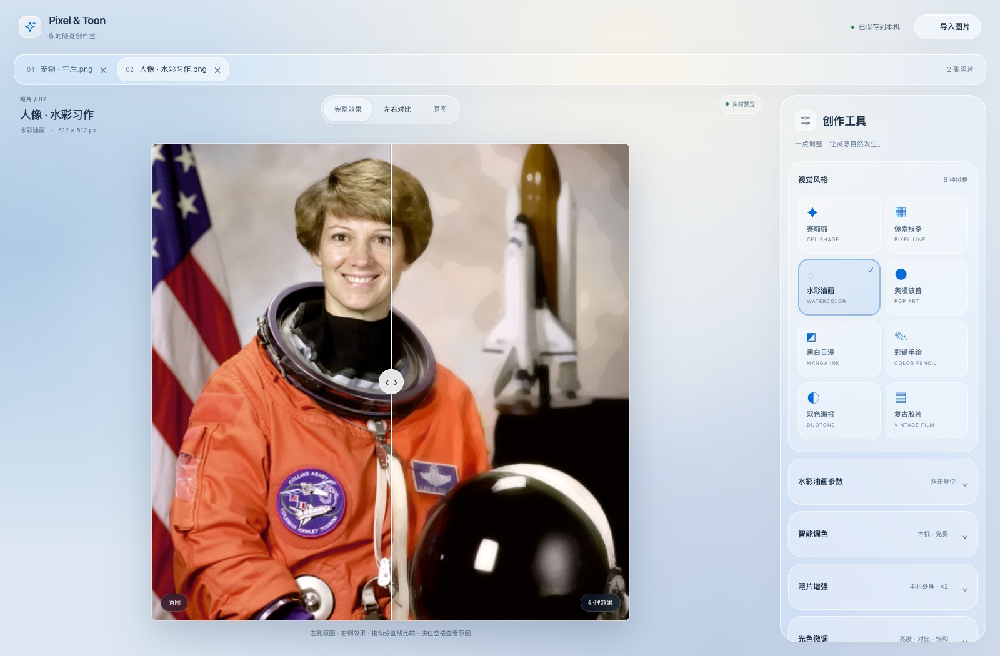
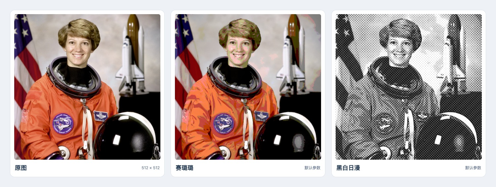
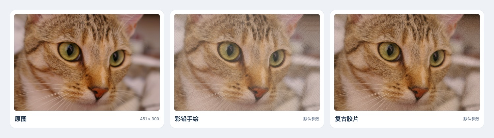
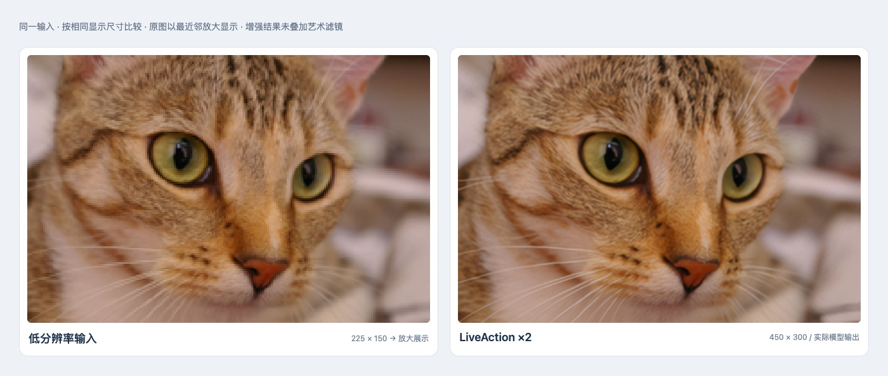
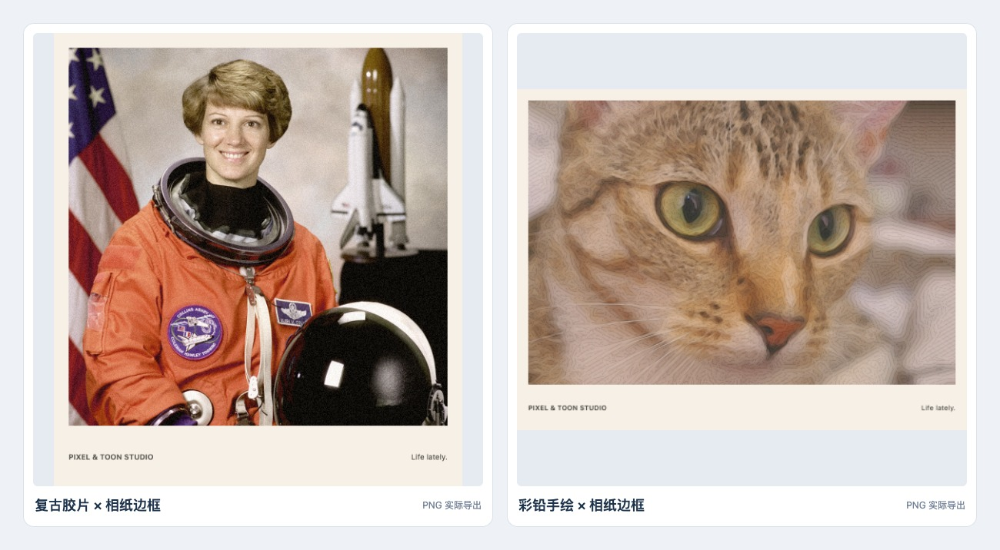

  
  <h1>Pixel & Toon Studio</h1>
  
<strong>把喜欢的照片，变成另一种风格。</strong>

  
八种艺术风格 · 本机照片增强 · 拍立得相框 · 高清 PNG 导出

  
Mac 桌面 / 网页 &nbsp; · &nbsp; 照片不上传 &nbsp; · &nbsp; 无需账号或 API Key

  

    <a href="https://github.com/feihanwen0928-eng/pixel-toon-studio/releases/latest"><strong>下载 Mac 版 ↗</strong></a>
    &nbsp; / &nbsp;
    <a href="#八种风格一张照片的八种表达">效果画廊</a>
    &nbsp; / &nbsp;
    <a href="#从导入到成品">功能一览</a>
    &nbsp; / &nbsp;
    <a href="docs/DEVELOPMENT.md">开发说明</a>
  

选一张照片，试试不同风格，再把光色、笔触和相框调到喜欢的样子。人像、宠物、旅行随拍，都可以在一个工作区里慢慢编辑；随时拖动分割线，看清原图与处理效果的变化。

## 八种风格，一张照片的八种表达

同一张原图，使用当前 v1.0 的默认参数实际导出。风格选好后，还能继续调整墨线、色块、笔触、网点、颗粒和配色。

| 风格 | 画面特点 | 可调细节 |
| :--- | :--- | :--- |
| **赛璐璐** | 动漫感色块与清晰轮廓 | 色阶、墨线、边缘、背景保护 |
| **像素线条** | 像素颗粒与插画线条 | 像素尺寸、细节过滤、色块数量 |
| **水彩油画** | 柔和的颜料融合与绘画笔触 | 笔触尺寸、画意强度、细节保留 |
| **美漫波普** | 漫画分色、细腻网点与墨线 | 网点大小与强度、色块、RGB 错位 |
| **黑白日漫** | 黑白墨线、网点阴影与留白 | 阴影层次、墨线、留白保护 |
| **彩铅手绘** | 彩铅线稿与纸面纹理 | 笔触、线稿、颜料浓度、纸张质感 |
| **双色海报** | 两种主色构成的海报感 | 暗部与亮部色相、分色位置、层次 |
| **复古胶片** | 温暖褪色、胶片颗粒与高光晕染 | 褪色、颗粒、色温、光晕 |

### 人像：从照片到动漫与日漫

左侧保留原图，中间是赛璐璐，右侧是黑白日漫。可以先看整体气质，再调整轮廓、明暗和阴影层次。

### 宠物：彩铅的柔软，胶片的温暖

同一张猫咪照片，分别尝试彩铅手绘与复古胶片。风格转换保留原有构图，不需要输入提示词。

## 照片增强，先整理底图的细节

**纹理清晰 / LiveAction ×2** 用于照片放大与纹理增强；**颗粒降噪 / FFDNet** 用于减少噪点，再放大到两倍尺寸。两种方式独立选择，可以直接下载增强底图，也可以接着叠加艺术风格。

> 上例为实际模型输出，未叠加艺术滤镜。两侧按相同显示尺寸展示，左侧低分辨率输入采用最近邻放大。处理效果随照片而变，小模型对严重失焦、运动模糊及缺失细节的恢复能力有限。

增强强度可以调整；不满意可以关闭、撤销或重新生成。**智能调色**也能独立开启，用来优化明暗、白平衡与色彩，再用亮度、对比度和饱和度做最后微调。

## 加一圈相纸，留下一句心情

打开拍立得相框，给成品加上暖白边框与留白签名。内置 **48 条中英文短句**，可按主题与语言挑选；经你同意，也可以展示照片中的拍摄信息。

相框、文字与处理效果一起导出，保存下来就能分享。

## 从导入到成品

| 想做什么 | 在这里怎么做 |
| :--- | :--- |
| **直接导入手机照片** | 支持 HEIC / HEIF、PNG、JPEG、WebP；可选择文件、拖入或粘贴 |
| **同时编辑几张照片** | 用标签切换，每张照片分别保留自己的风格与调整 |
| **看清改动** | 完整效果、左右对比、原图三种预览；按住空格临时查看原图 |
| **放心尝试** | 支持撤销、重做，双击滑块复位参数 |
| **下次接着编辑** | 工作区自动保存在本机，重新打开后恢复 |
| **保存最终成品** | 导出高清 PNG，包含增强、风格、调色和相框；不复制原始 EXIF |
| **在 Mac 上顺手打开** | 支持 Finder「打开方式」和拖到 Dock 图标，照片进入编辑标签 |

### 照片留在你的设备上

图片处理、HEIC 解码和模型推理都在本机完成。**不上传照片，不需要登录，不需要购买 API 调用。** Mac 安装包自带模型和运行时，可以离线使用；网页版在相应资源缓存完成后也支持离线编辑。

工作区适合继续创作，导出的 PNG 适合长期保存。Mac 与浏览器的工作区独立，清理浏览器站点数据会清空其中的照片和编辑记录。

## 下载即用

**[下载最新版 Mac 安装包 →](https://github.com/feihanwen0928-eng/pixel-toon-studio/releases/latest)**

支持 **Apple Silicon · macOS 13 或更新版本**。打开 DMG，把应用拖进「应用程序」，再导入一张照片即可开始，无需安装 Node.js 或使用终端。

当前版本采用 ad-hoc 签名，尚未进行 Apple 公证。如果 macOS 提示阻止打开，可在「系统设置 → 隐私与安全性」中选择「仍要打开」。Release 中同时提供 SHA-256 校验文件。

---

[开发与网页版运行说明](docs/DEVELOPMENT.md) · [展示图片与样片来源](docs/showcase/SOURCES.md) · [文案来源](docs/CAPTION_SOURCES.md) · [第三方许可](desktop/THIRD_PARTY_NOTICES.md) · [MIT License](LICENSE)

展示图片来自当前版本的真实界面与处理输出，未使用生成式图片替代效果；为了便于浏览，展示图经过排版、缩小和 JPEG 压缩，应用实际导出格式为 PNG。
